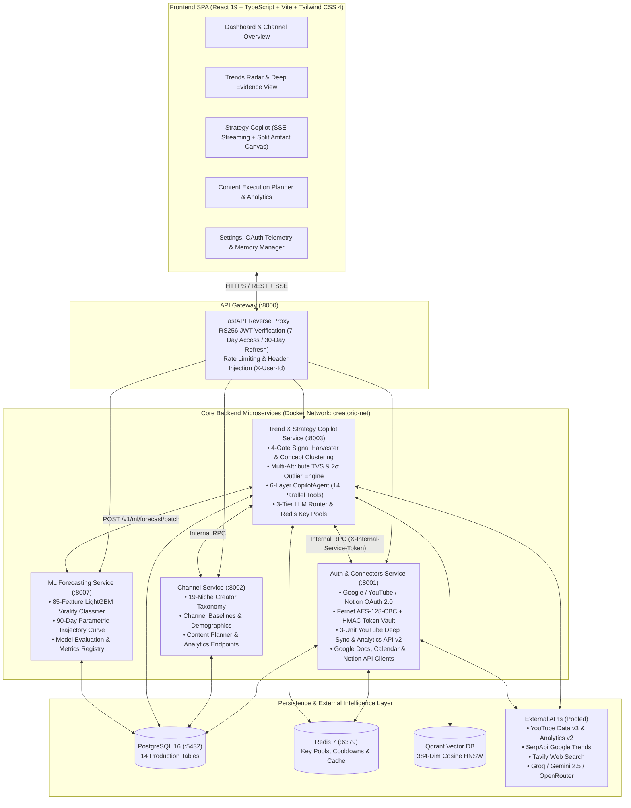

# CreatorIQ — Autonomous AI Trend Discovery, 85-Feature ML Virality Engine & Creator Copilot

CreatorIQ is a production-grade, microservice-based AI SaaS platform built for YouTube & Shorts creators. It unifies **live multi-source signal ingestion** (YouTube Data API v3, YouTube Analytics API v2, SerpApi Google Trends, and Tavily Web Search), **384-dimensional semantic concept clustering** (`sentence-transformers/all-MiniLM-L6-v2` + Qdrant HNSW), an **85-Feature LightGBM Virality Probability & 90-Day Trajectory Engine**, and a **6-Layer Context-Aware Autonomous Copilot (`CopilotAgent`)** connected directly to **Google Docs, Google Calendar, and Notion**.

---

## 📚 Master Technical Documentation Index

If you are reading this repository to understand the architecture, mathematical formulations, algorithms, or database models from first principles, read our comprehensive engineering documentation in [`docs/`](./docs/):

| Document | Core Subject & Contents |
| :--- | :--- |
| **[`docs/ALGORITHMS_AND_MATHEMATICAL_MODELS.md`](./docs/ALGORITHMS_AND_MATHEMATICAL_MODELS.md)** | **Complete Mathematical & Algorithmic Specification:** All 7 core algorithms with formal LaTeX equations, pseudocode, and Mermaid diagrams (3-Unit YouTube Deep Sync, 4-Gate Signal Harvester, 384-Dim MiniLM + Qdrant HNSW Clustering, Multi-Attribute TVS + $2\sigma$ Outlier Scoring, 85-Feature LightGBM Virality Classifier + 90-Day Trajectory Curve, Redis Multi-Key Pool Rotation + 3-Tier LLM Router, and Frontend Expectancy Models). |
| **[`docs/COPILOT_AGENT_AND_CONNECTORS_ARCHITECTURE.md`](./docs/COPILOT_AGENT_AND_CONNECTORS_ARCHITECTURE.md)** | **Autonomous Copilot & OAuth Connectors Deep Dive:** 6-Layer Living Creator Context Graph, Parallel `asyncio.gather` Tool Execution with isolated `SessionLocal()` per task, all 14 Agent Tools (`AGENT_TOOLS`), Silent Background Memory Extraction (`CreatorMemory`), SSE Event Streaming protocol, and the 4 OAuth Workspace Connectors. |
| **[`docs/PROPHET_PIPELINE_AND_ARCHITECTURE.md`](./docs/PROPHET_PIPELINE_AND_ARCHITECTURE.md)** | **ML Forecasting & 85-Feature LightGBM Pipeline (`:8007`):** Deep dive into `ForecastEngine`, 85 engineered temporal/velocity/ratio features, `SimpleImputer(strategy="median")`, `scale_pos_weight` class-imbalance compensation, and 90-day parametric trajectory projection (`emerging` → `growing` → `peaking` → `declining`). |
| **[`docs/TRENDS_ENGINE_SPEC.md`](./docs/TRENDS_ENGINE_SPEC.md)** | **Trends Discovery & Scoring Specification:** Ingestion pipeline, subscriber-normalized Reach Ratio ($R_v$) and Interaction Density ($I_v$), 19 canonical niches, and snapshot caching. |
| **[`docs/UI_TREND_CARDS_AND_FORECAST_EXPLAINABILITY.md`](./docs/UI_TREND_CARDS_AND_FORECAST_EXPLAINABILITY.md)** | **Psychology-Driven Light-Theme SaaS UI & Explainability:** Design system (`#FBFAF8` canvas, `#FFFFFF` cards, `#FF98C1` pink primary actions, `#91F5D3` mint signals), card hierarchy, and transparent evidence attribution. |
| **[`docs/TECHNICAL_VIVA_AND_SYSTEM_DEFENSE.md`](./docs/TECHNICAL_VIVA_AND_SYSTEM_DEFENSE.md)** | **System Defense & Architectural Q&A:** Comprehensive engineering justification for every architectural, mathematical, and systems decision in CreatorIQ. |
| **[`backend/docs/master_schema.md`](./backend/docs/master_schema.md)** | **PostgreSQL 16 + Qdrant Master Database Schema:** Complete Entity-Relationship (ER) diagrams and column specifications for all 14 production tables. |
| **[`backend/docs/service_registry.md`](./backend/docs/service_registry.md)** | **Microservice Registry & Internal RPC Contracts:** Inter-service communication patterns, port mappings, and security headers (`X-User-Id`, `X-Internal-Service-Token`). |

---

## 🏗️ High-Level System Architecture

CreatorIQ runs as a containerized microservice architecture orchestrated via Docker Compose over an internal bridge network (`creatoriq-net`).



---

## 🧠 Core Engineering Pillars & Algorithms

### 1. Zero-Single-Point-of-Failure Redis Key Pool (`RedisKeyPool`) & 3-Tier LLM Router
To eliminate API quota exhaustion and single-provider downtime, all external API keys (`YOUTUBE_API_KEYS`, `SERPAPI_API_KEYS`, `TAVILY_API_KEYS`, `GROQ_API_KEYS`, `GEMINI_API_KEYS`, `OPENROUTER_API_KEYS`) are managed by an atomic Redis round-robin pool:
- **Atomic Rotation:** `INCR creatoriq:keypool:{pool_name}:idx` distributes requests evenly across $N$ keys.
- **Scoped Cooldown Quarantine:** On HTTP `429` or `403`, `SETEX creatoriq:keypool:{pool_name}:cooldown:{sha256_prefix} <ttl> "1"` quarantines only the exhausted key while seamlessly failing over to the next healthy key.
- **3-Tier LLM Failover (`llm_router.py`):**
  1. **Tier 1 — Groq LPU (`llama-3.3-70b-versatile`):** Ultra-low latency (~300 tokens/sec) primary inference and parallel tool calling.
  2. **Tier 2 — Google Gemini (`gemini-2.5-flash`):** Native `functionDeclarations` translator and high-context fallback.
  3. **Tier 3 — OpenRouter (`openai/gpt-4o-mini`):** Universal fallback guarantee.

### 2. 4-Gate Signal Harvesting, 384-Dim Vector Deduplication & Multi-Attribute TVS
1. **4-Gate Signal Quality Filter:** Rejects shorts/clips (`< 90s`), non-fresh uploads (`> 14 days`), low-traction videos (`< 1,000 views`), and non-target scripts (`< 70% Latin characters`).
2. **Subscriber-Normalized Velocity:** Computes **Reach Ratio** ($R_v = \text{clamp}(V_v / \max(S_c, 100) / 5.0, 0, 1) \times 100$) and **Interaction Density** ($I_v = \text{clamp}((L_v + 2C_v)/V_v / 0.08, 0, 1) \times 100$) so small breakout channels compete fairly with mega-channels.
3. **Semantic Clustering:** Encodes titles into $\mathbb{R}^{384}$ via `all-MiniLM-L6-v2` and queries Qdrant (`cosine >= 0.80`) to merge duplicate videos into canonical `TrendConcept` entities.
4. **Trend Velocity Score ($\text{TVS} \in [0, 100]$):**
   $$\text{TVS}_c = \text{round}\Big(\text{clamp}\big(0.60 \cdot \bar{M}_c + 0.40 \cdot E_{\text{raw}}(c) + \Delta_{\text{accel}}(c),\ 0,\ 100\big),\ 1\Big)$$
5. **$2\sigma$ Breakout Outlier Detection:** Flags videos exceeding their channel's historical mean by $\ge 2.0\sigma$ ($Z_v = (V_v - \mu_{\text{ch}}) / \sigma_{\text{ch}} \ge 2.0$).

### 3. 85-Feature LightGBM Virality Classifier & 90-Day Trajectory Engine (`:8007`)
- **85 Engineered Features:** Spanning 7-day rolling view lags (`views_lag_1..7`), day-over-day velocity derivatives (`vel_1d`, `vel_3d`, `vel_7d`), acceleration (`accel_1d_3d`), engagement ratios (`like_view_ratio`, `comment_view_ratio`), channel baselines (`views_vs_channel_mean`, `sub_view_ratio`), and cyclic date encodings (`dow_sin`, `dow_cos`).
- **Imbalance-Aware Gradient Boosted Trees:** Trained with `n_estimators=300`, `learning_rate=0.04`, `SimpleImputer(strategy="median")`, and dynamic `scale_pos_weight = N_neg / N_pos`.
- **90-Day Trajectory Projection:** Combines LightGBM virality probability $P_{\text{viral}} \in [0, 1]$ with current momentum to project a 90-day daily trajectory curve (`yhat`, `yhat_lower`, `yhat_upper`), identifying exact peak windows and lifecycle states (`emerging`, `growing`, `peaking`, `declining`).

### 4. Autonomous `CopilotAgent` & 4 OAuth Workspace Connectors
- **6-Layer Living Creator Context Graph:** Every prompt is hydrated with (1) Creator Identity & Measured Retention (`averageViewPercentage` from YouTube Analytics API v2), (2) Long-Term Facts (`CreatorMemory`), (3) Recent Outliers & Videos, (4) Live Niche Radar (`TrendConcept` top TVS), (5) Saved Trends & Past Chat Summaries, and (6) Active OAuth Connector Statuses.
- **Parallel Multi-Tool Execution (`asyncio.gather`):** Executes up to 14 specialized tools concurrently, each in its own isolated SQLAlchemy `SessionLocal()` session.
- **4 Bidirectional OAuth Connectors:**
  1. **YouTube Channel & Analytics (`youtube`):** 3-unit quota-efficient deep sync (`channels.list` → `playlistItems.list` → `videos.list`) + YouTube Analytics API v2 measured retention.
  2. **Google Docs (`google_docs`):** 1-click export of full scripts and strategy briefs into formatted Google Docs.
  3. **Google Calendar (`google_calendar`):** Direct production scheduling onto the creator's primary calendar.
  4. **Notion (`notion`):** Automated page creation with native Notion block formatting (`heading_2`, `bulleted_list_item`, `paragraph`).

---

## 🎨 Psychology-Driven Light-Theme SaaS Frontend

Built around the creator decision journey (**DISCOVER → EVALUATE → DECIDE → CREATE → PLAN → LEARN**), the frontend enforces a strict, high-contrast **Light-Only SaaS Design System**:
- **Color Architecture:** Warm off-white application canvas (`#FBFAF8`), pure white elevated cards (`#FFFFFF`), pale lavender context groupings (`#F6F3FF`), pastel pink primary CTAs (`#FF98C1`), mint positive signal badges (`#91F5D3`), and high-contrast ink typography (`#171717`).
- **Interactive Copilot Studio (`/app/strategy`):** Features live SSE token streaming, collapsible tool-execution pills, a split-screen **Strategy Canvas** for scripts/tables, a **Sources & Telemetry Drawer**, and 1-click **Save to Docs / Notion** and **Schedule on Calendar** actions on every assistant response.

---

## ⚡ Quick Start (Local Development)

### 1. Start All Backend Microservices (Docker Compose)
```powershell
cd backend
.\scripts\docker-up.ps1
```
Or manually via Docker Compose:
```bash
cd backend
docker compose up -d --build
```

### 2. Start Frontend Development Server
```bash
cd frontend
npm install
npm run dev
```
- **Frontend UI:** `http://localhost:5173`
- **API Gateway Entrypoint:** `http://localhost:8000/v1`

---

## 🔌 Microservice Port Registry

| Service | Container Name | Internal/Host Port | Responsibility |
| :--- | :--- | :--- | :--- |
| **API Gateway** | `ciq-api-gateway` | `8000` | Reverse proxy, RS256 JWT validation, request correlation, rate limiting |
| **Auth & Connectors** | `ciq-auth` | `8001` | User auth, RS256 JWT issuance, Fernet OAuth vault, YouTube/Docs/Calendar/Notion sync |
| **Channel Service** | `ciq-channel` | `8002` | Creator profile, 19-niche taxonomy, channel metrics, planner & analytics APIs |
| **Trend & Strategy** | `ciq-trend` | `8003` | 4-Gate ingestion, Qdrant clustering, TVS scoring, `CopilotAgent`, 14 tools, LLM router |
| **ML Forecast Engine** | `ciq-ml` | `8007` | 85-Feature LightGBM virality classifier & 90-day trajectory projection |
| **PostgreSQL 16** | `ciq-postgres` | `5432` | Relational persistence across 14 core tables |
| **Redis 7** | `ciq-redis` | `6379` | Atomic multi-key rotation pools, cooldown locks, feed caching |
