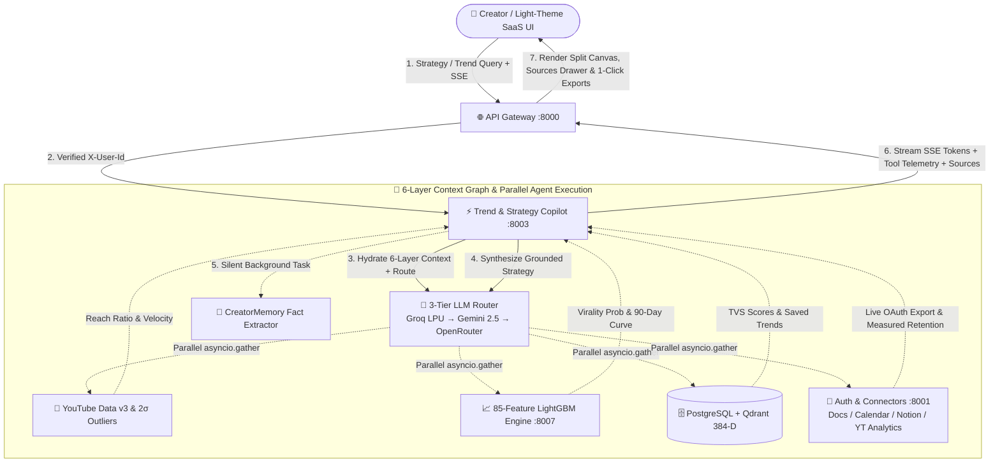

# 🚀 CreatorIQ — AI Trend Discovery, 85-Feature LightGBM Virality Engine & Creator Copilot

CreatorIQ is an autonomous AI co-pilot and growth intelligence platform for YouTube & Shorts creators. It combines live multi-source signal ingestion (YouTube Data API v3, YouTube Analytics API v2, SerpApi Google Trends, Tavily Web Search), 384-dimensional Qdrant vector clustering, an **85-Feature LightGBM Virality Classifier & 90-Day Trajectory Engine**, and a **6-Layer Context-Aware Copilot (`CopilotAgent`)** with native **Google Docs, Google Calendar, and Notion OAuth Connectors**.

> 📖 **Deep-Dive Documentation:**
> - [Algorithms & Mathematical Models (`docs/ALGORITHMS_AND_MATHEMATICAL_MODELS.md`)](./docs/ALGORITHMS_AND_MATHEMATICAL_MODELS.md)
> - [Copilot Agent & OAuth Connectors (`docs/COPILOT_AGENT_AND_CONNECTORS_ARCHITECTURE.md`)](./docs/COPILOT_AGENT_AND_CONNECTORS_ARCHITECTURE.md)
> - [85-Feature LightGBM & Trajectory Pipeline (`docs/PROPHET_PIPELINE_AND_ARCHITECTURE.md`)](./docs/PROPHET_PIPELINE_AND_ARCHITECTURE.md)

---

## 🏗️ System Architecture & Parallel Agent Tool Flow



---

## ✨ Core Capabilities

### 1. 🤖 6-Layer Personalized `CopilotAgent` & 14 Parallel Tools
- **6-Layer Living Creator Context Graph**: Automatically injects creator identity, measured YouTube Analytics retention (`averageViewPercentage`), long-term `CreatorMemory` facts, recent $2\sigma$ channel outliers, live niche radar (`TrendConcept`), and OAuth connector states into every turn.
- **Parallel Multi-Tool Execution (`asyncio.gather`)**: Executes up to 14 tools concurrently using isolated SQLAlchemy `SessionLocal()` sessions per task (`get_youtube_trends`, `predict_trend_forecast_ml`, `find_small_channel_outliers`, `search_web`, `create_google_doc`, `schedule_calendar_event`, `create_notion_page`, etc.).
- **3-Tier Redis-Pooled LLM Router**: Atomic round-robin key rotation (`RedisKeyPool`) with automatic per-key `429` cooldown across **Groq (`llama-3.3-70b-versatile`) → Gemini (`gemini-2.5-flash`) → OpenRouter (`gpt-4o-mini`)**.

### 2. 📈 85-Feature LightGBM Virality & 90-Day Trajectory Engine (`:8007`)
- Evaluates 85 temporal, velocity, acceleration, engagement-density, and channel-baseline features (`n_estimators=300`, `learning_rate=0.04`, `SimpleImputer(strategy="median")`, `scale_pos_weight`).
- Projects a **90-day daily trajectory curve** (`yhat`, `yhat_lower`, `yhat_upper`), identifying exact peak windows and lifecycle stages (*emerging, growing, peaking, declining*).

### 3. 🎯 4-Gate Trends Radar & $2\sigma$ Breakout Outlier Engine
- **Subscriber-Normalized Velocity**: Scores trends using **Reach Ratio** ($R_v$), **Interaction Density** ($I_v$), and **Trend Velocity Score (TVS)** so small breakout channels surface alongside major creators.
- **384-Dim Qdrant Clustering**: Deduplicates cross-platform signals via `all-MiniLM-L6-v2` cosine similarity ($\ge 0.80$).

### 4. 🎨 Psychology-Driven Light-Theme SaaS Workspace
- **Strict Light-Only Design System**: Warm off-white background (`#FBFAF8`), crisp white surfaces (`#FFFFFF`), pastel pink primary CTAs (`#FF98C1`), mint positive indicators (`#91F5D3`), and high-contrast ink typography (`#171717`).
- **1-Click Workspace Exports**: Export any AI strategy brief directly to **Google Docs** or **Notion**, or schedule filming directly onto **Google Calendar**.

---

## ⚡ Quick Start

```bash
# 1. Start Backend Microservices (:8000, :8001, :8002, :8003, :8007, Postgres, Redis)
cd backend
docker compose up -d --build

# 2. Start Frontend Dev Server (:5173)
cd frontend
npm run dev
```
