# CreatorIQ Master Database Schema (PostgreSQL 16 + Qdrant + Redis)

This document defines the complete production database schema across all 14 relational tables in PostgreSQL 16, alongside the Qdrant 384-dimensional vector collection and Redis key-pool namespace structure.

---

## 1. Complete Entity-Relationship (ER) Diagram

```mermaid
erDiagram
    users ||--o{ oauth_connections : "authenticates (4 providers)"
    users ||--o{ channels : "owns"
    users ||--o| creator_profiles : "configures onboarding"
    users ||--o{ saved_trends : "bookmarks"
    users ||--o{ chat_sessions : "converses in"
    users ||--o{ creator_memory : "accumulates facts"
    users ||--o{ agent_tool_call_logs : "audits tool calls"

    channels ||--o{ channel_outliers : "produces 2sigma breakouts"
    trend_concepts ||--o{ concept_daily_signals : "tracks daily time-series"
    trend_concepts ||--o{ channel_outliers : "clusters videos into"
    trend_concepts ||--o{ saved_trends : "referenced by"
    trends ||--o{ saved_trends : "legacy reference"

    chat_sessions ||--o{ chat_messages : "contains turns"
    chat_sessions ||--o{ creator_memory : "extracts facts from"

    users {
        uuid id PK
        string email UK
        string hashed_password
        string full_name
        string avatar_url
        boolean is_active
        boolean onboarding_completed
        timestamp created_at
    }

    oauth_connections {
        uuid id PK
        uuid user_id FK
        string provider "youtube | google_docs | google_calendar | notion"
        string provider_account_id
        text access_token_enc "Fernet AES-128-CBC + HMAC"
        text refresh_token_enc "Fernet AES-128-CBC + HMAC"
        jsonb scopes
        jsonb metadata_json "workspace_name, channel_id, synced_at"
        timestamp expires_at
        timestamp updated_at
    }

    channels {
        uuid id PK
        uuid user_id FK
        string youtube_channel_id UK
        string title
        string handle
        bigint subscriber_count
        bigint total_views
        integer video_count
        float avg_views_per_video "mu_ch (last 50 uploads)"
        float std_views_per_video "sigma_ch (last 50 uploads)"
        float engagement_rate
        float avg_retention_pct "Measured via YT Analytics API v2"
        jsonb top_videos_json "Top 10 videos + recent uploads"
        timestamp last_synced_at
    }

    creator_profiles {
        uuid id PK
        uuid user_id FK
        string primary_niche "19 canonical niches"
        jsonb sub_niches
        string content_format "long_form | shorts | hybrid"
        string tone_style
        string target_region "ISO-3166 e.g. IN, US, GB"
        string language
        integer uploads_per_week
        jsonb goals_json
        timestamp updated_at
    }

    trend_concepts {
        uuid id PK
        string canonical_title
        string primary_niche
        string qdrant_point_id "UUID in Qdrant 384-D collection"
        float tvs_score "0.0 to 100.0"
        float momentum_score "0.0 to 100.0"
        float engagement_score "0.0 to 100.0"
        string lifecycle_stage "emerging | growing | peaking | declining"
        float virality_prob "LightGBM P(viral) in [0, 1]"
        integer video_count
        bigint total_views
        jsonb evidence_videos_json "Top contributing YouTube videos + R_v, I_v"
        jsonb forecast_payload_json "90-day trajectory yhat, yhat_lower, yhat_upper"
        jsonb ai_enrichment_json "why_trending, angles, title_ideas"
        timestamp first_seen_at
        timestamp last_updated_at
    }

    concept_daily_signals {
        uuid id PK
        uuid concept_id FK
        date signal_date
        bigint total_views
        bigint total_likes
        bigint total_comments
        integer active_video_count
        float avg_momentum
        float tvs_snapshot
        float serp_interest_score "0 to 100 from SerpApi Google Trends"
    }

    channel_outliers {
        uuid id PK
        uuid concept_id FK
        string youtube_video_id UK
        string youtube_channel_id
        string channel_title
        bigint channel_subscribers
        string video_title
        bigint view_count
        bigint like_count
        bigint comment_count
        float channel_avg_views "mu_ch"
        float channel_std_views "sigma_ch"
        float z_score "(V_v - mu_ch) / sigma_ch >= 2.0"
        float multiplier "V_v / mu_ch"
        float reach_ratio "R_v"
        float interaction_density "I_v"
        timestamp published_at
    }

    trend_feed_snapshots {
        uuid id PK
        uuid user_id FK
        string niche
        string region
        jsonb top_trends_json "Personalized Top 5 snapshot"
        timestamp created_at
    }

    saved_trends {
        uuid id PK
        uuid user_id FK
        uuid trend_id FK "Nullable legacy FK"
        uuid concept_id FK "FK to trend_concepts.id"
        string notes
        timestamp created_at
    }

    chat_sessions {
        uuid id PK
        uuid user_id FK
        string title
        uuid attached_trend_id
        timestamp created_at
        timestamp updated_at
    }

    chat_messages {
        uuid id PK
        uuid session_id FK
        string role "user | assistant | system"
        text content "Markdown response"
        jsonb tool_calls_json "Executed tools, duration_ms, sources"
        timestamp created_at
    }

    creator_memory {
        uuid id PK
        uuid user_id FK
        string memory_type "preference | constraint | audience_insight | past_decision | style_rule"
        text fact "Concise 1-sentence atomic fact"
        float confidence "0.60 to 1.00"
        uuid source_session_id FK
        boolean is_active "Soft-delete flag"
        timestamp created_at
        timestamp updated_at
    }

    agent_tool_call_logs {
        uuid id PK
        uuid user_id FK
        uuid session_id FK
        string tool_name
        jsonb tool_args
        string status "success | error"
        integer duration_ms
        timestamp created_at
    }

    ml_evaluations {
        uuid id PK
        string model_version "e.g. lgbm_85f_v3"
        float roc_auc
        float f1_score
        float precision_score
        float recall_score
        jsonb top_features_json
        timestamp evaluated_at
    }
```

---

## 2. Vector & Cache Storage Layers

### 2.1 Qdrant Vector Collection (`trend_concepts_v2`)
- **Dimensionality:** $\mathbb{R}^{384}$ generated by `sentence-transformers/all-MiniLM-L6-v2` with $L_2$ unit normalization.
- **Distance Metric:** Cosine Similarity ($\cos(\theta) = \hat{e}_1 \cdot \hat{e}_2$).
- **Deduplication Threshold:** $\theta_{\text{sim}} = 0.80$ within the same `primary_niche`.
- **Payload Schema:** `{"concept_id": "<uuid>", "canonical_title": "<str>", "niche": "<str>", "updated_at": "<iso8601>"}`.

### 2.2 Redis 7 Key Namespaces (`ciq-redis :6379`)
| Redis Key Pattern | Data Type | TTL | Purpose |
| :--- | :--- | :--- | :--- |
| `creatoriq:keypool:{pool_name}:idx` | `INTEGER` | Permanent | Atomic counter (`INCR`) for round-robin key selection across `youtube`, `serpapi`, `tavily`, `groq`, `gemini`, `openrouter` pools |
| `creatoriq:keypool:{pool_name}:cooldown:{sha256_12}` | `STRING` | `90s`–`3600s` | Per-key rate-limit quarantine marker (`SETEX`) upon HTTP `429` or `403` |
| `oauth_state:{state_token}` | `JSON` | `600s` | CSRF state & redirect context during OAuth 2.0 authorization flows |
| `trend_feed:{user_id}:{niche}:{region}` | `JSON` | `900s` | Personalized Top-5 trend feed cache |
