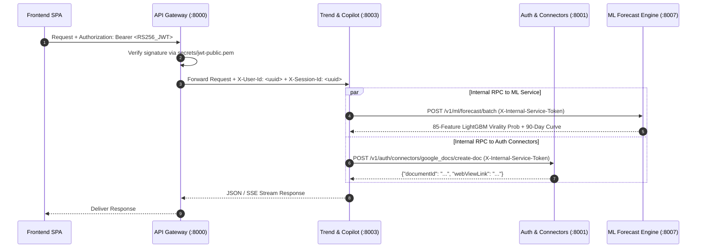

# CreatorIQ Service Registry & Internal RPC Guide

This document defines the responsibilities, port mappings, security headers, and internal HTTP RPC contracts across the 5 active microservices in the CreatorIQ backend.

---

## 1. Active Microservice Map

| Service | Container | Port | Primary Responsibility | Key Dependencies |
| :--- | :--- | :--- | :--- | :--- |
| **API Gateway** | `ciq-api-gateway` | `8000` | Reverse proxy, RS256 JWT verification, rate limiting, `X-User-Id` & `X-Session-Id` header injection | Auth, Channel, Trend, ML |
| **Auth & Connectors** | `ciq-auth` | `8001` | User registration/login, RS256 JWT issuance (7-day access / 30-day refresh), Fernet AES-128-CBC OAuth vault, 3-Unit YouTube Deep Sync, YouTube Analytics API v2 measured retention, Google Docs, Google Calendar & Notion execution | PostgreSQL, Redis, Google/YouTube/Notion APIs |
| **Channel Service** | `ciq-channel` | `8002` | Creator profile & 7-step onboarding, 19-niche taxonomy, channel overview metrics, content planner & analytics endpoints | PostgreSQL, Auth |
| **Trend & Strategy** | `ciq-trend` | `8003` | 4-Gate signal harvester, 384-D `all-MiniLM-L6-v2` + Qdrant clustering, Multi-Attribute TVS & $2\sigma$ outlier scoring, `CopilotAgent` (6-layer context + 14 parallel tools), 3-tier LLM router & `RedisKeyPool` | PostgreSQL, Redis, Qdrant, ML (`:8007`), Auth (`:8001`), Channel (`:8002`) |
| **ML Forecast Engine** | `ciq-ml` | `8007` | 85-Feature LightGBM Virality Classifier (`ForecastEngine`) & 90-day parametric trajectory projection (`emerging` / `growing` / `peaking` / `declining`) | PostgreSQL |

---

## 2. Authentication & Inter-Service Security Architecture

### Security Headers
1. **External → Gateway (`Authorization: Bearer <token>`):**
   - Verified at the edge by `ciq-api-gateway` using the RSA-2048 public key (`secrets/jwt-public.pem`).
   - Access tokens expire after **7 days** (`ACCESS_TOKEN_EXPIRE_MINUTES = 10080`); refresh tokens expire after **30 days**.
2. **Gateway → Internal Microservices (`X-User-Id`, `X-Session-Id`):**
   - The Gateway strips spoofed internal headers from external requests and injects the verified `X-User-Id` and correlation `X-Session-Id`.
3. **Microservice → Microservice (`X-Internal-Service-Token`):**
   - Internal RPC calls (such as `ciq-trend` calling `ciq-auth` to execute a Google Docs export or `ciq-ml` to score a batch of concepts) authenticate via the shared `INTERNAL_SERVICE_TOKEN` secret.

---

## 3. Core Internal RPC Endpoints

### 3.1 Auth & Connectors Service (`http://auth:8001`)
- `GET /v1/auth/connectors/status?user_id={uuid}` — Returns connection status, scopes, and metadata for `youtube`, `google_docs`, `google_calendar`, and `notion`.
- `POST /v1/auth/connectors/youtube/sync` — Executes the 3-unit YouTube Data API v3 deep sync + YouTube Analytics API v2 measured `averageViewPercentage` retention sync.
- `POST /v1/auth/connectors/google_docs/create-doc` — Decrypts user's Fernet token, refreshes if expired, and creates a Google Doc containing the strategy brief.
- `POST /v1/auth/connectors/google_calendar/create-event` — Schedules a production event on the creator's primary Google Calendar.
- `POST /v1/auth/connectors/notion/create-page` — Creates a formatted Notion strategy page with heading and bullet blocks.

### 3.2 ML Forecast Service (`http://ml:8007`)
- `POST /v1/ml/forecast` — Computes the 85-feature LightGBM virality probability and 90-day trajectory curve for a single `TrendConcept`.
- `POST /v1/ml/forecast/batch` — Batch inference endpoint used during feed generation and `CopilotAgent` tool execution.
- `GET /v1/ml/metrics` — Returns model evaluation metrics (`ROC-AUC`, `F1`, feature importances).

### 3.3 Trend & Strategy Service (`http://trend:8003`)
- `GET /v1/trends` — Personalized Top-5 and full niche radar with TVS, Reach Ratio ($R_v$), Interaction Density ($I_v$), and LightGBM forecast curves.
- `GET /v1/trends/outliers` — $2\sigma$ breakout videos filtered by creator niche and minimum multiplier.
- `POST /v1/strategy/chat/stream` — SSE streaming endpoint for `CopilotAgent` with live `tool_start`, `tool_end`, `token`, `sources`, and `done` events.
- `GET /v1/strategy/memory` & `DELETE /v1/strategy/memory/{memory_id}` — Long-term `CreatorMemory` fact management.
