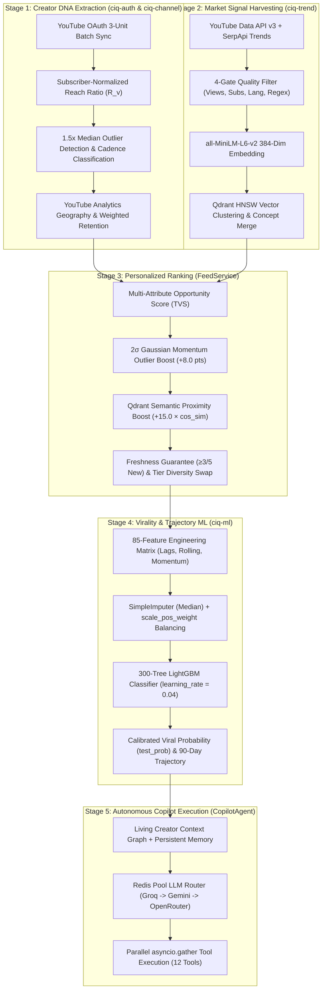
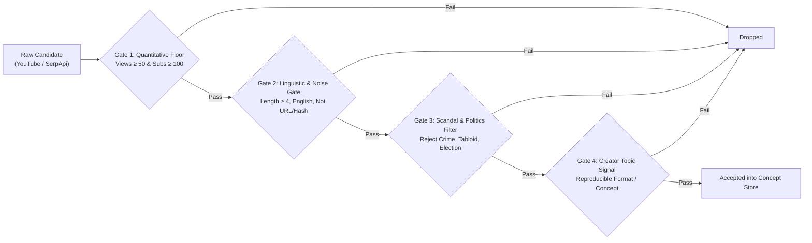
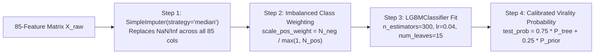
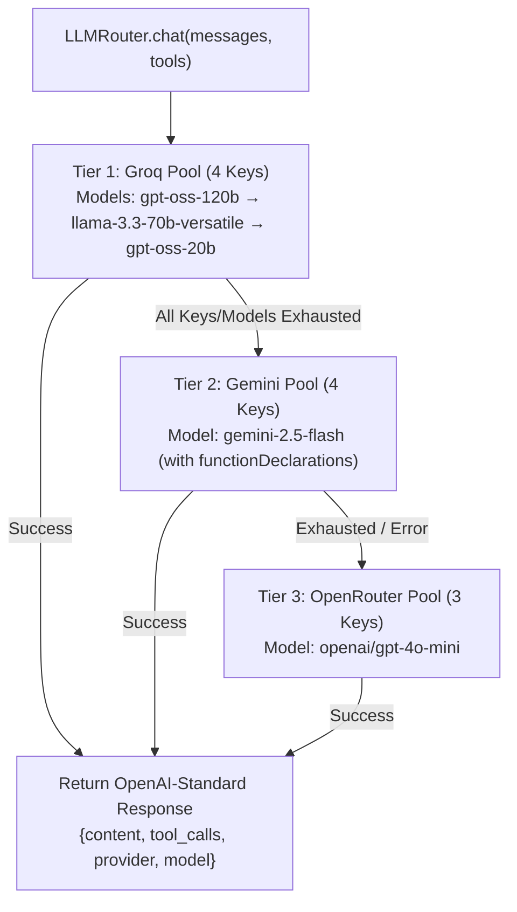

# CreatorIQ — Complete Algorithms & Mathematical Models Reference

**Version:** 3.0 (Production Implementation)  
**Scope:** Formal mathematical definitions, step-by-step pseudocode, feature matrices, and architectural flowcharts for every core algorithm running in CreatorIQ.

> [!IMPORTANT]
> Every equation, threshold, weight, and algorithm documented in this guide corresponds directly to the production Python and TypeScript source code. File paths are linked throughout so engineers can jump straight from the mathematical formulation to the exact code implementation.

---

## Table of Contents

1. [System-Wide Algorithmic Pipeline Overview](#1-system-wide-algorithmic-pipeline-overview)
2. [Algorithm 1: 3-Unit YouTube OAuth Deep Sync & Channel DNA Extraction](#2-algorithm-1-3-unit-youtube-oauth-deep-sync--channel-dna-extraction)
3. [Algorithm 2: Multi-Source Signal Harvesting, Quality Gating & Diversity Bucketing](#3-algorithm-2-multi-source-signal-harvesting-quality-gating--diversity-bucketing)
4. [Algorithm 3: 384-Dimensional Dense Semantic Embedding & Qdrant HNSW Search](#4-algorithm-3-384-dimensional-dense-semantic-embedding--qdrant-hnsw-search)
5. [Algorithm 4: Multi-Attribute Opportunity Score (TVS) & 2σ Outlier Detection](#5-algorithm-4-multi-attribute-opportunity-score-tvs--2σ-outlier-detection)
6. [Algorithm 5: 85-Feature LightGBM Virality Classifier & 90-Day Trajectory Engine](#6-algorithm-5-85-feature-lightgbm-virality-classifier--90-day-trajectory-engine)
7. [Algorithm 6: Redis-Backed Multi-Key Pool Rotation & 3-Tier LLM Failover](#7-algorithm-6-redis-backed-multi-key-pool-rotation--3-tier-llm-failover)
8. [Algorithm 7: Frontend Expectancy & Reach Estimation Models](#8-algorithm-7-frontend-expectancy--reach-estimation-models)

---

## 1. System-Wide Algorithmic Pipeline Overview

CreatorIQ operates as a closed-loop quantitative intelligence pipeline across seven interconnected mathematical stages:



---

## 2. Algorithm 1: 3-Unit YouTube OAuth Deep Sync & Channel DNA Extraction

**Source Files:**
- [`backend/services/auth/app/services/auth_service.py`](file:///c:/Users/Yash/VS_PROJECTS/CreatorIQ/backend/services/auth/app/services/auth_service.py#L797-L1025)
- [`backend/services/auth/app/integrations/youtube_analytics_client.py`](file:///c:/Users/Yash/VS_PROJECTS/CreatorIQ/backend/services/auth/app/integrations/youtube_analytics_client.py)
- [`backend/services/channel/app/services/creator_context_pipeline.py`](file:///c:/Users/Yash/VS_PROJECTS/CreatorIQ/backend/services/channel/app/services/creator_context_pipeline.py)

### 2.1 Why the 3-Unit Batch Architecture Exists
The YouTube Data API v3 enforces a strict default quota of $10,000$ units/day per API key, where a single `search.list` call costs **100 units**. If CreatorIQ used `search.list` to inspect a creator's recent uploads upon login, just 100 logins would exhaust an entire key's daily quota.

Instead, `_sync_deep()` extracts a creator's complete 50-video historical performance DNA using **exactly 3 quota units total**:
1. **Unit 1 (`channels.list`, cost = 1 unit):** Fetches `snippet,statistics,contentDetails,topicDetails` for `mine=true`, extracting subscriber count $S$, total views $V_{\text{total}}$, video count $N_{\text{vid}}$, and the `uploads` playlist ID $P_{\text{uploads}}$.
2. **Unit 2 (`playlistItems.list`, cost = 1 unit):** Fetches the 50 most recent upload video IDs $\{v_1, v_2, \dots, v_{50}\}$ from $P_{\text{uploads}}$.
3. **Unit 3 (`videos.list`, cost = 1 unit):** Batches all 50 video IDs into a single comma-separated request (`id=v1,v2,...,v50`) with `part=snippet,contentDetails,statistics`.

### 2.2 Mathematical Formulations for Channel DNA

Let $S_{\text{raw}}$ be the channel's subscriber count, and let $S = \max(1, S_{\text{raw}})$ be the safe denominator. For each video $i \in \{1, \dots, M\}$ (where $M \le 50$) with view count $V_i$, like count $L_i$, comment count $C_i$, and ISO-8601 duration $D_i$ (in seconds):

1. **Per-Video Format Classification:**
   $$\text{Format}(v_i) = \begin{cases} \text{shorts} & \text{if } 0 < D_i \le 60 \\ \text{long\_form} & \text{if } D_i > 60 \end{cases}$$

2. **Channel Primary Format Detection:**
   Let $N_{\text{shorts}}$ and $N_{\text{long}}$ be the counts of Shorts and Long-form videos among the $M$ uploads:
   $$\text{ChannelFormat} = \begin{cases} \text{shorts} & \text{if } \frac{N_{\text{shorts}}}{M} \ge 0.70 \\ \text{long\_form} & \text{if } \frac{N_{\text{long}}}{M} \ge 0.70 \\ \text{both} & \text{otherwise} \end{cases}$$

3. **Subscriber-Normalized Reach Ratio ($R_i$) & Channel Baseline ($R_{\text{med}}$):**
   $$R_i = \text{round}\left(\frac{V_i}{S}, 3\right), \quad R_{\text{med}} = \text{median}\left(\{R_1, R_2, \dots, R_M\}\right)$$

4. **Breakout Outlier Identification ($1.5\times$ Baseline Threshold):**
   A video $v_i$ is classified as a historical channel outlier if its reach ratio exceeds $1.5\times$ the channel's own median reach baseline:
   $$\text{IsOutlier}(v_i) \iff R_i \ge 1.5 \times R_{\text{med}}$$
   The top 5 videos sorted by $(\text{IsOutlier}(v_i), R_i)$ descending are persisted to the `channel_outliers` table so Copilot can reference the creator's proven winners.

5. **Channel Engagement Rate ($E_{\text{channel}}$):**
   $$E_{\text{channel}} = \text{round}\left( \frac{\sum_{i=1}^M (L_i + C_i)}{\max\left(1, \sum_{i=1}^M V_i\right)} \times 100, \, 2 \right)$$

6. **Publishing Cadence Classification (Median Inter-Upload Gap):**
   Given sorted upload timestamps $t_1 \ge t_2 \ge \dots \ge t_M$, let the inter-upload gaps in days be $\Delta_k = \max\left(0.1, \frac{t_k - t_{k+1}}{86400}\right)$ and $\Delta_{\text{med}} = \text{median}(\{\Delta_k\})$:
   $$\text{Cadence} = \begin{cases} \text{daily} & \text{if } \Delta_{\text{med}} \le 2.5\text{ days} \\ \text{weekly} & \text{if } 2.5 < \Delta_{\text{med}} \le 9.0\text{ days} \\ \text{biweekly} & \text{if } 9.0 < \Delta_{\text{med}} \le 18.0\text{ days} \\ \text{monthly} & \text{if } \Delta_{\text{med}} > 18.0\text{ days} \end{cases}$$

7. **View-Weighted Audience Retention (`averageViewPercentage`):**
   From YouTube Analytics API v2 (`dimensions=day`, `metrics=views,averageViewPercentage` over a 28-day window), given daily views $v_d$ and daily average view percentage $p_d$:
   $$\text{Retention}_{28\text{d}} = \frac{\sum_{d=1}^{28} v_d \cdot p_d}{\sum_{d=1}^{28} v_d}$$

8. **Audience Geography Weight Vector ($\mathbf{A}$):**
   Given country view counts $\{(c_1, V_{c_1}), \dots, (c_K, V_{c_K})\}$ over a 90-day lookback:
   $$A_{c_k} = \text{round}\left(\frac{V_{c_k}}{\sum_{j=1}^K V_{c_j}}, 4\right), \quad \sum_{k=1}^K A_{c_k} = 1.0$$

9. **Channel Profile Maturity State Machine (`classify_maturity`):**
   $$\text{Maturity}(N_{\text{vid}}, S) = \begin{cases} \text{new} & \text{if } N_{\text{vid}} = 0 \\ \text{early} & \text{if } 1 \le N_{\text{vid}} \le 4 \\ \text{growing} & \text{if } 5 \le N_{\text{vid}} < 20 \text{ or } S < 1000 \\ \text{established} & \text{if } N_{\text{vid}} \ge 20 \text{ and } S \ge 1000 \end{cases}$$

---

## 3. Algorithm 2: Multi-Source Signal Harvesting, Quality Gating & Diversity Bucketing

**Source Files:**
- [`backend/services/trend/app/services/concept_collector.py`](file:///c:/Users/Yash/VS_PROJECTS/CreatorIQ/backend/services/trend/app/services/concept_collector.py)
- [`backend/services/trend/app/services/youtube_video_collector.py`](file:///c:/Users/Yash/VS_PROJECTS/CreatorIQ/backend/services/trend/app/services/youtube_video_collector.py)
- [`backend/services/trend/app/services/quality_filters.py`](file:///c:/Users/Yash/VS_PROJECTS/CreatorIQ/backend/services/trend/app/services/quality_filters.py)

### 3.1 4-Stage Signal Quality Gate

Every candidate topic or video harvested from YouTube Data API v3 or SerpApi Google Trends must pass four deterministic gates before entering `trend_concepts` or `concept_daily_signals`:



### 3.2 Daily Concept Signal Aggregation (`ConceptDailySignal`)

For each canonical concept $C$ on date $d$, let its accepted video population be $\mathcal{P}_{C,d} = \{v_1, \dots, v_K\}$. For each video $v_k \in \mathcal{P}_{C,d}$:
- **Reach Ratio:** $r_k = \frac{\text{views}(v_k)}{\max(\text{subscribers}(v_k), 100)}$
- **Interaction Density:** $i_k = \frac{\text{likes}(v_k) + 2 \cdot \text{comments}(v_k)}{\max(\text{views}(v_k), 1)}$
- **Channel Size Bucket:**
  - **Small Channel:** $\text{subscribers}(v_k) < 10,000$
  - **Medium Channel:** $10,000 \le \text{subscribers}(v_k) \le 100,000$
  - **Big Channel:** $\text{subscribers}(v_k) > 100,000$

The daily aggregated signal stored in `concept_daily_signals` computes:
$$\text{reach\_ratio\_median}_{C,d} = \text{median}(\{r_1, \dots, r_K\})$$
$$\text{interaction\_density\_median}_{C,d} = \text{median}(\{i_1, \dots, i_K\})$$
$$\text{outlier\_streak}_{C,d} = \begin{cases} \text{outlier\_streak}_{C,d-1} + 1 & \text{if } \text{trend\_score\_median}_{C,d} > \mu_d + 2\sigma_d \\ 0 & \text{otherwise} \end{cases}$$

---

## 4. Algorithm 3: 384-Dimensional Dense Semantic Embedding & Qdrant HNSW Search

**Source File:** [`backend/services/trend/app/services/vector_service.py`](file:///c:/Users/Yash/VS_PROJECTS/CreatorIQ/backend/services/trend/app/services/vector_service.py)

### 4.1 Model & Geometry
CreatorIQ uses **`sentence-transformers/all-MiniLM-L6-v2`** loaded as a process-wide lazy singleton (`_get_model()`) to map any text string into $\mathbb{R}^{384}$:
$$\mathbf{e}(x) = \frac{\text{MiniLM}(x)}{\|\text{MiniLM}(x)\|_2} \in \mathbb{R}^{384}$$

When indexing a `TrendConcept` $C$, the input document combines its canonical title and niche taxonomy tags:
$$x_C = \text{canonical\_title}(C) \oplus \text{" "} \oplus \text{join}(\text{niche\_tags}(C))$$

### 4.2 Cosine Similarity & Feed Ranking Boost
Qdrant indexes all concept vectors in the `trend_concepts` collection using an **HNSW (Hierarchical Navigable Small World)** graph with **Cosine Distance**:
$$\text{sim}(\mathbf{q}, \mathbf{e}_C) = \frac{\mathbf{q} \cdot \mathbf{e}_C}{\|\mathbf{q}\|_2 \|\mathbf{e}_C\|_2} \in [-1, 1]$$

When generating a creator's personalized feed, we construct the creator query vector $\mathbf{q}_{\text{creator}} = \mathbf{e}(\text{niches} \oplus \text{tone})$, retrieve all concepts with $\text{sim}(\mathbf{q}_{\text{creator}}, \mathbf{e}_C) \ge 0.50$, and apply an additive semantic proximity boost of up to $+15.0$ points:
$$\text{Score}_{\text{semantic}} = \min\left(100.0, \, \text{TVS} + 15.0 \times \text{sim}(\mathbf{q}_{\text{creator}}, \mathbf{e}_C)\right)$$

---

## 5. Algorithm 4: Multi-Attribute Opportunity Score (TVS) & 2σ Outlier Detection

**Source Files:**
- [`backend/services/trend/app/services/scoring.py`](file:///c:/Users/Yash/VS_PROJECTS/CreatorIQ/backend/services/trend/app/services/scoring.py)
- [`backend/services/trend/app/services/feed_service.py`](file:///c:/Users/Yash/VS_PROJECTS/CreatorIQ/backend/services/trend/app/services/feed_service.py)

### 5.1 Step 1 — Raw Market Momentum ($M_{\text{raw}}$)
Combines normalized YouTube video velocity ($V_{\text{vid}} \in [0, 100]$), YouTube search velocity ($V_{\text{search}} \in [0, 100]$), Google Trends growth ($G_{\text{trends}} \in [0, 100]$), normalized search volume ($\text{Vol}_{\text{norm}} \in [0, 100]$), and capped news recency boost ($B_{\text{news}} \le 20$):
$$M_{\text{raw}} = \min\left(100.0, \; 0.40 V_{\text{vid}} + 0.15 V_{\text{search}} + 0.15 G_{\text{trends}} + 0.10 \text{Vol}_{\text{norm}} + 0.05 \min(B_{\text{news}}, 20.0)\right)$$

### 5.2 Step 2 — Lexical & Taxonomy Niche Fit ($F_{\text{niche}}$)
Given user niches $U = \{u_1, \dots, u_m\}$, concept tags $T$, concept title $W$, and niche taxonomy keywords $K_U$:
1. **Tag Overlap Indicator:** $\mathbb{I}_{\text{tag}} = 1$ if $\exists u \in U, t \in T$ such that $u \subseteq t$ or $t \subseteq u$, else $0$.
2. **Lexical Title Hit Score ($H_{\text{title}}$):**
   - $+1.5$ for each $u \in U$ appearing in $W$
   - $+1.0$ for each keyword $k \in K_U$ appearing in $W$
   - Normalized: $S_{\text{title}} = \min\left(1.0, \frac{H_{\text{title}}}{\max(2.0 \cdot |U|, 1)}\right)$
3. **Piecewise Niche Fit Function (with Tag-Only Cap $\tau_{\text{cap}} = 0.55$):**
   $$F_{\text{niche}} = \begin{cases} 0.70 \cdot S_{\text{title}} & \text{if } \mathbb{I}_{\text{tag}} = 0 \\ \min(1.0, 0.45 + 0.55 \cdot S_{\text{title}}) & \text{if } \mathbb{I}_{\text{tag}} = 1 \land \text{HasCreatorSignal}(W) \land S_{\text{title}} \ge 0.25 \\ \min(0.55, S_{\text{title}} + 0.30) & \text{if } \mathbb{I}_{\text{tag}} = 1 \land S_{\text{title}} < 0.20 \\ \min(1.0, 0.35 + 0.65 \cdot S_{\text{title}}) & \text{otherwise} \end{cases}$$

### 5.3 Step 3 — Audience-Weighted Geographic Relevance ($F_{\text{geo}}$)
Dot product between the creator's normalized audience country distribution $\mathbf{A}$ and the concept's normalized country strength $\mathbf{G}$:
$$F_{\text{geo}} = \min\left(1.0, \sum_{c \in \text{Countries}} A_c \cdot G_c\right)$$

### 5.4 Step 4 — Format Fit ($F_{\text{fmt}}$)
$$F_{\text{fmt}} = \begin{cases} 1.0 & \text{if user\_format} = \text{both} \lor \text{user\_format} \in \text{supported\_formats} \\ 0.6 & \text{otherwise} \end{cases}$$

### 5.5 Step 5 — Composite Opportunity Score (TVS) & $2\sigma$ Outlier Bonus
$$\text{TVS}_{\text{base}} = \left( 0.50 \cdot \frac{M_{\text{raw}}}{100.0} + 0.25 \cdot F_{\text{niche}} + 0.20 \cdot F_{\text{geo}} + 0.05 \cdot F_{\text{fmt}} \right) \times 100.0$$

Across the candidate concept pool $\{C_1, \dots, C_N\}$, let $\mu_M = \frac{1}{N}\sum M_{\text{raw}}(C_i)$ and $\sigma_M = \sqrt{\frac{1}{N}\sum (M_{\text{raw}}(C_i) - \mu_M)^2}$. If $M_{\text{raw}}(C_i) > \mu_M + 2.0\sigma_M$, the concept is flagged as a **Breakout Momentum Outlier** and receives a $+8.0$ bonus:
$$\text{TVS}_{\text{final}} = \min\left(99.0, \; \text{TVS}_{\text{base}} + 15.0 \cdot \text{sim}(\mathbf{q}, \mathbf{e}_C) + 8.0 \cdot \mathbb{I}(M_{\text{raw}} > \mu_M + 2\sigma_M)\right)$$

---

## 6. Algorithm 5: 85-Feature LightGBM Virality Classifier & 90-Day Trajectory Engine

**Source File:** [`backend/services/ml/app/services/forecast_engine.py`](file:///c:/Users/Yash/VS_PROJECTS/CreatorIQ/backend/services/ml/app/services/forecast_engine.py)

### 6.1 Complete 85-Feature Engineering Matrix (`FEATURE_COLUMNS_85`)

The ML service transforms daily concept time series into an exact **85-dimensional feature vector** $\mathbf{x}_t \in \mathbb{R}^{85}$ for every day $t$:

| Feature Group | Count | Exact Feature Names / Construction Formula |
| :--- | :---: | :--- |
| **1. Base Daily Metrics** | **9** | `trend_score`, `population_size`, `reach_ratio_median`, `interaction_density_median`, `semantic_score_mean`, `outlier_streak`, `big_channel_count`, `medium_channel_count`, `small_channel_count` |
| **2. Historical Lag Features** | **25** | For each $m \in \{\text{trend\_score}, \text{reach\_ratio\_median}, \text{interaction\_density\_median}, \text{semantic\_score\_mean}, \text{population\_size}\}$ and each horizon $L \in \{1, 3, 7, 14, 28\}$:<br/>$$m\text{\_lag\_}L\text{d}(t) = m(t - L)$$ |
| **3. Rolling Window Mean & Std** | **40** | For each of the 5 core metrics $m$ above and each window $W \in \{3, 7, 14, 28\}$:<br/>$$m\text{\_roll\_mean\_}W\text{d}(t) = \frac{1}{W}\sum_{k=0}^{W-1} m(t-k), \quad m\text{\_roll\_std\_}W\text{d}(t) = \text{std}\left(\{m(t-k)\}_{k=0}^{W-1}\right)$$ |
| **4. Momentum & Acceleration** | **8** | • `trend_momentum_3d` $= S_t - S_{t-3}$<br/>• `trend_momentum_7d` $= S_t - S_{t-7}$<br/>• `trend_momentum_14d` $= S_t - S_{t-14}$<br/>• `trend_acceleration_7d` $= \text{trend\_momentum\_7d}(t) - \text{trend\_momentum\_7d}(t-7)$<br/>• `reach_ratio_momentum_7d` $= R_t - R_{t-7}$<br/>• `interaction_density_momentum_7d` $= I_t - I_{t-7}$<br/>• `semantic_score_momentum_7d` $= \text{Sem}_t - \text{Sem}_{t-7}$<br/>• `population_momentum_7d` $= P_t - P_{t-7}$ |
| **5. Creator Tier Audience Shares** | **3** | Let $P_t = \max(1, \text{population\_size}_t)$:<br/>• `small_share` $= \text{small\_channel\_count}_t / P_t$<br/>• `medium_share` $= \text{medium\_channel\_count}_t / P_t$<br/>• `big_share` $= \text{big\_channel\_count}_t / P_t$ |
| **Total Features** | **85** | **$9 + 25 + 40 + 8 + 3 = 85$ Features** |

### 6.2 4-Step LightGBM Training & Probability Calibration Pipeline



1. **Step 1 — Median Imputation (`SimpleImputer`):**
   Early historical rows (where $t < 28$) have `NaN` values for 14-day and 28-day lags. `SimpleImputer(strategy="median", keep_empty_features=True)` replaces missing values with the column median, followed by `np.nan_to_num(..., nan=0.0)`.
2. **Step 2 — Viral Target Labeling & Imbalanced Class Weighting (`scale_pos_weight`):**
   Each historical observation is labeled $y_t \in \{0, 1\}$ using the composite virality benchmark:
   $$C_t = 0.50\left(\frac{S_t}{100}\right) + 0.25\,\text{clip}\left(\frac{\Delta_7 S_t + 12}{30}, 0, 1\right) + 0.15\,\text{clip}\left(\frac{R_t}{1.4}, 0, 1\right) + 0.10\,\text{clip}(\text{small\_share}_t, 0, 1)$$
   $$y_t = \mathbb{I}(C_t \ge 0.56)$$
   Because genuine viral breakouts are the minority class ($\approx 30\%$), class imbalance is corrected via:
   $$\text{scale\_pos\_weight} = \frac{N_{\text{neg}}}{\max(1, N_{\text{pos}})}$$
3. **Step 3 — 300-Tree Sequential Gradient Boosted Classifier:**
   ```python
   model = lgb.LGBMClassifier(
       n_estimators=300,
       learning_rate=0.04,
       scale_pos_weight=scale_pos_weight,
       num_leaves=15,
       min_child_samples=8,
       reg_alpha=1.2,      # L1 regularization
       reg_lambda=2.5,     # L2 regularization
       subsample=0.85,
       colsample_bytree=0.85,
       random_state=42,
   )
   ```
4. **Step 4 — Posterior Probability Calibration & Feature Importance Extraction:**
   Let $P_{\text{tree}}(\mathbf{x}_t) = \text{model.predict\_proba}(\mathbf{x}_t)_{1}$ be the raw ensemble probability from the 300 trees, and $P_{\text{prior}}(t) = \text{clip}(S_t / 100, 0.05, 0.95)$:
   $$\text{test\_prob}_t = \text{clip}\left(0.75 \cdot P_{\text{tree}}(\mathbf{x}_t) + 0.25 \cdot P_{\text{prior}}(t), \; 0.02, \; 0.96\right)$$
   - **Classification Thresholds:**
     - $\text{test\_prob} \ge 0.65 \implies \texttt{viral\_breakout}$
     - $0.42 \le \text{test\_prob} < 0.65 \implies \texttt{growing\_candidate}$
     - $\text{test\_prob} < 0.42 \implies \texttt{baseline}$

### 6.3 90-Day Forward Trajectory Equations ($\hat{y}_{t+d}, \hat{y}_{\text{lower}}, \hat{y}_{\text{upper}}$)

Given current score $S_0$, calibrated viral probability $p = \text{test\_prob}$, 7-day momentum $m_7 = \text{trend\_momentum\_7d}$, and 7-day rolling standard deviation $\sigma_7 = \text{trend\_score\_roll\_std\_7d}$:
- **Viral Lift:** $L_{\text{viral}} = (p - 0.38) \times 38.0$
- **Weekly Publishing Seasonality Wave:** $w(d) = 1.4 \sin\left(\frac{2\pi d}{7}\right)$
- **Piecewise Lifecycle Trajectory ($d \in \{1, \dots, 90\}$):**
  - **Regime A (`emerging` / `growing` or $p \ge 0.60$):**
    $$\tilde{y}(d) = \begin{cases} S_0 + \max(4.0, L_{\text{viral}})\left(\frac{d}{28}\right)^{0.78} + 0.15 m_7 \left(\frac{d}{28}\right) & 1 \le d \le 28 \text{ (Ascent)} \\ S_{\text{peak}} \left(1 - 0.07 \frac{d - 28}{27}\right) & 28 < d \le 55 \text{ (Plateau)} \\ 0.93 \, S_{\text{peak}} \left(1 - 0.16 \frac{d - 55}{35}\right) & 55 < d \le 90 \text{ (Maturity)} \end{cases}$$
  - **Regime B (`peaking`):** Peaks at $d = 10$, then decays gradually over $d \in [11, 90]$.
  - **Regime C (`declining` and $p < 0.60$):**
    $$\tilde{y}(d) = S_0 \cdot \max\left(0.30, \; 1 - \frac{d}{90} \cdot \max(0.15, 0.48(1 - p))\right)$$
- **Uncertainty Corridor ($\hat{y}_{\text{lower}}, \hat{y}_{\text{upper}}$):**
  With base volatility $B_{\text{CI}} = \text{clip}(1.65 \cdot \sigma_7, 3.0, 14.0)$:
  $$\hat{y}(d) = \text{clip}(\tilde{y}(d) + w(d), 5.0, 98.0)$$
  $$\Delta_{\text{CI}}(d) = B_{\text{CI}} \left(1 + 0.45 \frac{d}{90}\right), \quad [\hat{y}_{\text{lower}}(d), \hat{y}_{\text{upper}}(d)] = [\hat{y}(d) - \Delta_{\text{CI}}(d), \, \hat{y}(d) + \Delta_{\text{CI}}(d)]$$

---

## 7. Algorithm 6: Redis-Backed Multi-Key Pool Rotation & 3-Tier LLM Failover

**Source Files:**
- [`backend/services/trend/app/core/key_pool.py`](file:///c:/Users/Yash/VS_PROJECTS/CreatorIQ/backend/services/trend/app/core/key_pool.py)
- [`backend/services/trend/app/core/llm_router.py`](file:///c:/Users/Yash/VS_PROJECTS/CreatorIQ/backend/services/trend/app/core/llm_router.py)

### 7.1 Redis Atomic Round-Robin & Cooldown State Machine (`RedisKeyPool`)
CreatorIQ maintains 6 independent Redis-backed key pools (`youtube`, `groq`, `gemini`, `openrouter`, `tavily`, `serpapi`). Given $K$ keys $\{k_0, k_1, \dots, k_{K-1}\}$ for a provider $P$:

1. **Selection (`get_active_key`):**
   - Atomically increments Redis counter `ciq:keypool:{P}:cursor` via `INCR` to get cursor $c$.
   - Probes indices $i_m = (c + m) \bmod K$ for $m = 0, \dots, K-1$.
   - Checks if exhaustion key `ciq:keypool:{P}:exhausted:{suffix}` exists in Redis.
   - Returns the first non-exhausted key $k_{i_m}$. (If all $K$ keys are marked exhausted, falls back to $k_{c \bmod K}$ as a last-resort probe).
2. **Quota Exhaustion (`mark_exhausted`):**
   - On HTTP `429` / `401` / `403` (quota exceeded), sets `SETEX ciq:keypool:{P}:exhausted:{suffix} <TTL> <reason>`:
     - Daily quota errors (`daily`, `quotaExceeded`): $\text{TTL} = 86,400\text{s}$ (24 hours).
     - Per-minute rate limits (`rate_limit`): $\text{TTL} = 60\text{s}$.
3. **Telemetry (`record_usage`):**
   - Atomically increments `ciq:keypool:{P}:usage:{YYYY-MM-DD}:{suffix}` with a 48-hour expiry.

### 7.2 3-Tier Multi-Provider LLM Router (`LLMRouter.chat`)



---

## 8. Algorithm 7: Frontend Expectancy & Reach Estimation Models

**Source File:** [`frontend/src/lib/viewEstimator.ts`](file:///c:/Users/Yash/VS_PROJECTS/CreatorIQ/frontend/src/lib/viewEstimator.ts)

To help creators evaluate whether a trend is worth filming, the frontend computes deterministic view ranges and reach multipliers from real search volume $V_{\text{search}}$, subscriber count $S$, Opportunity Score $\text{TVS}$, and 1-week forecast change $\Delta_{\text{1w}}\%$:

1. **Tier Capture Rate ($[c_{\min}, c_{\max}]$):**
   - Small ($S < 10\text{K}$): $[0.8\%, 2.5\%]$
   - Medium ($10\text{K} \le S \le 100\text{K}$): $[2.0\%, 5.5\%]$
   - Big ($S > 100\text{K}$): $[5.0\%, 14.0\%]$
2. **Trajectory Growth Multiplier ($G_{\text{boost}}$):**
   $$G_{\text{boost}} = 1.0 + \text{clip}\left(\frac{\Delta_{\text{1w}}\%}{100}, -0.15, 0.50\right)$$
3. **Expected Reach Multiplier vs. Channel Average:**
   $$\text{Multiplier} = \text{round}\left(1.2 + 2.0 \left(\frac{\text{TVS}}{100}\right) + 0.012 \cdot \max(0, \Delta_{\text{1w}}\%), \; 1\right)$$
