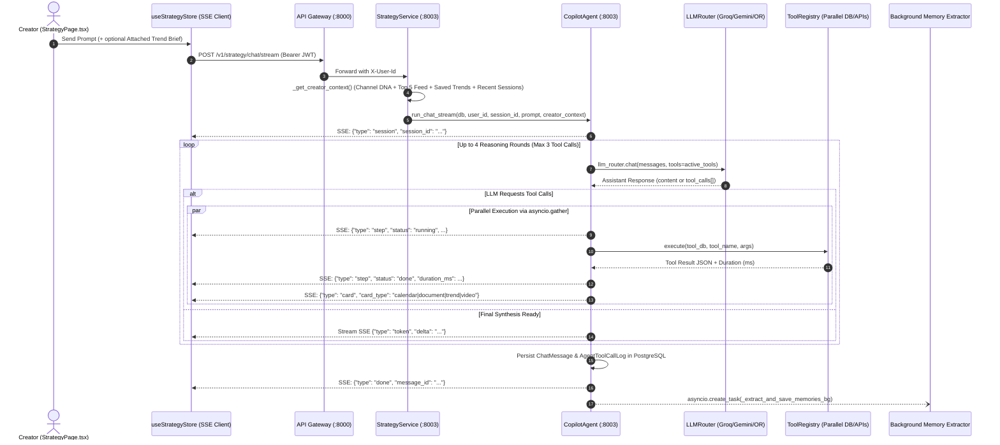
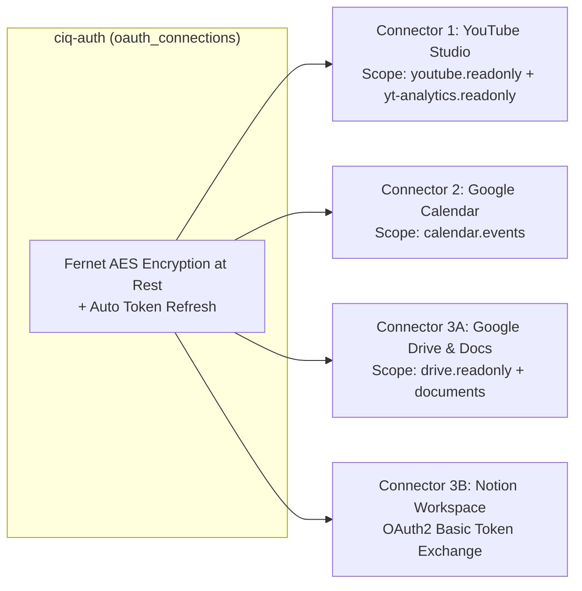

# CreatorIQ — Autonomous Copilot Agent & Workspace Connectors Architecture

**Version:** 3.0 (Production Implementation)  
**Scope:** End-to-end technical specification of the CreatorIQ Copilot Agent (`CopilotAgent`), the Living Creator Context Graph, the 12-Tool Registry (`ToolRegistry`), Parallel Tool Execution, Silent Background Memory Extraction (`CreatorMemory`), SSE Streaming Protocol, and the 4 OAuth Workspace Connectors.

---

## Table of Contents

1. [Architectural Philosophy: Why CreatorIQ Copilot Feels Connected](#1-architectural-philosophy-why-creatoriq-copilot-feels-connected)
2. [End-to-End Copilot Request & Streaming Lifecycle](#2-end-to-end-copilot-request--streaming-lifecycle)
3. [The Living Creator Context Graph](#3-the-living-creator-context-graph)
4. [Autonomous Multi-Turn ReAct Loop & Parallel Tool Execution](#4-autonomous-multi-turn-react-loop--parallel-tool-execution)
5. [Complete 12-Tool Registry Specification (`AGENT_TOOLS`)](#5-complete-12-tool-registry-specification-agent_tools)
6. [Silent Background Memory Extraction (`CreatorMemory`)](#6-silent-background-memory-extraction-creatormemory)
7. [The 4 OAuth Workspace Connectors (Deep Dive)](#7-the-4-oauth-workspace-connectors-deep-dive)
8. [SSE Streaming Protocol & Frontend Interactive UI Physics](#8-sse-streaming-protocol--frontend-interactive-ui-physics)

---

## 1. Architectural Philosophy: Why CreatorIQ Copilot Feels Connected

Generic AI wrappers fail creators because every conversation starts from a blank slate (`stateless prompt -> generic 3-title table`). CreatorIQ Copilot is engineered around four pillars inspired by Claude and ChatGPT:

1. **Zero-Cold-Start Context Graph:** Before generating a single token, Copilot assembles the creator's live YouTube channel DNA (subscriber count, median reach ratio, proven outlier uploads), their active Top 5 dashboard trends, their bookmarked concepts, their long-term learned memories, any attached Trend Detail brief, and a summary of their 3 most recent chat sessions.
2. **Intent-Adaptive Intelligence:** Copilot matches its output structure to the creator's exact intent—executing direct calendar scheduling, conversational script sparring, or deep multi-tool research without dumping robotic templates.
3. **Parallel Multi-Tool Grounding:** When Copilot needs live evidence across multiple sources (e.g., `search_trends` + `find_small_channel_outliers` + `search_web`), it executes all tools concurrently via `asyncio.gather` with isolated database sessions.
4. **Direct Workspace Execution:** Copilot doesn't just talk—it reads and writes directly to the creator's **Google Calendar**, **Google Docs / Drive**, and **Notion Workspace**.

---

## 2. End-to-End Copilot Request & Streaming Lifecycle



---

## 3. The Living Creator Context Graph

**Source Files:**
- [`backend/services/trend/app/services/strategy_service.py`](file:///c:/Users/Yash/VS_PROJECTS/CreatorIQ/backend/services/trend/app/services/strategy_service.py#L221-L310)
- [`backend/services/trend/app/agent/copilot_agent.py`](file:///c:/Users/Yash/VS_PROJECTS/CreatorIQ/backend/services/trend/app/agent/copilot_agent.py#L218-L355)

Every turn in `CopilotAgent.run_chat_stream` constructs a structured system prompt anchored by six live data layers:

| Layer | Source Service / Table | Injected Signals |
| :--- | :--- | :--- |
| **1. Temporal Anchor** | Python `datetime.now(IST)` | Exact current IST timestamp and a 7-day rolling calendar lookup (`Monday Oct 26, 2026 (2026-10-26)`, etc.) so relative dates like *"this Friday at 7:30 PM"* resolve with 100% accuracy. |
| **2. Channel Performance DNA** | `ciq-channel` (`/internal/channels/user/{id}/context`) | Channel name, `@handle`, subscriber count, primary niches, tone, country, median reach ratio ($R_{\text{med}}$), dominant traffic source (`browse` vs `search`), measured retention percentage, and top 3 historical outlier videos. |
| **3. Attached Trend Opportunity Brief** | `TrendDetailPage.tsx` $\to$ `trend_context` payload | When navigating from a Trend Detail page: canonical topic, Opportunity Score, lifecycle, reach multiple, outlier streak, *why trending*, hook blueprint, curated title angles, and top 3 breakout proof videos. |
| **4. Active Dashboard & Saved Trends** | `trend_feed_snapshots`, `saved_trends` $\bowtie$ `trend_concepts` | The creator's current Top 5 ranked opportunities on their dashboard plus up to 8 bookmarked trends (`TrendConcept.canonical_title`). |
| **5. Persistent Creator Memory** | `creator_memory` table (`MemoryRepository`) | Up to 15 high-confidence personal facts, style rules, filming constraints, and active video projects learned across past conversations. |
| **6. Cross-Session Episodic Continuity** | `chat_sessions` $\bowtie$ `chat_messages` | Titles and final conclusions of the creator's 3 most recent prior chat sessions so Copilot remembers what they discussed yesterday. |

---

## 4. Autonomous Multi-Turn ReAct Loop & Parallel Tool Execution

**Source File:** [`backend/services/trend/app/agent/copilot_agent.py`](file:///c:/Users/Yash/VS_PROJECTS/CreatorIQ/backend/services/trend/app/agent/copilot_agent.py#L360-L515)

### 4.1 Why Parallel Tool Execution with Per-Task DB Sessions Matters
In standard SQLAlchemy `AsyncSession` architectures, sharing a single `db: AsyncSession` across concurrent coroutines in `asyncio.gather` raises `InvalidRequestError: This session is provisioning a new connection; concurrent operations are not permitted`.

CreatorIQ solves this in [`copilot_agent.py`](file:///c:/Users/Yash/VS_PROJECTS/CreatorIQ/backend/services/trend/app/agent/copilot_agent.py#L455-L485):
1. When the LLM emits $M$ tool calls $\{T_1, \dots, T_M\}$ in a single reasoning round:
   - All $M$ `{"type": "step", "status": "running"}` SSE events are yielded immediately to the frontend UI.
   - If $M = 1$, the tool executes on the request's existing `db` session.
   - If $M > 1$, each coroutine in `asyncio.gather(*[_run_single_tool(pc) for pc in prepared_calls])` opens its own isolated `async with SessionLocal() as tool_db:` session, executes the tool, and commits cleanly.
2. Each tool output is compacted via `_compact_tool_result_for_llm(tool_result, max_chars=2400)` before appending to `messages` so multi-tool turns never exceed Groq's TPM context budget.

---

## 5. Complete 12-Tool Registry Specification (`AGENT_TOOLS`)

**Source File:** [`backend/services/trend/app/agent/tool_registry.py`](file:///c:/Users/Yash/VS_PROJECTS/CreatorIQ/backend/services/trend/app/agent/tool_registry.py)

| # | Tool Name | Connector Gate | Backing Data Source / API | Purpose & Output |
| :-: | :--- | :--- | :--- | :--- |
| 1 | `get_my_channel` | Always Available | `creator_context` (`ciq-channel`) | Returns connected channel name, subscriber count, niches, tone, formats, and top geographies. |
| 2 | `get_channel_outliers` | `youtube` | `channel_outliers` (`ciq-channel`) | Returns the creator's historical breakout uploads ($\ge 1.5\times$ median reach ratio) with view counts and format types. |
| 3 | `get_my_saved_trends` | Always Available | `saved_trends` $\bowtie$ `trend_concepts` | Returns all concepts bookmarked by the creator with opportunity scores and lifecycle stages. |
| 4 | `search_trends` | Always Available | `trend_concepts` (PostgreSQL) | Searches the scored trend catalog by keyword and minimum opportunity score. Emits interactive `trend` cards. |
| 5 | `get_trend_detail` | Always Available | `trend_concepts` $\bowtie$ `concept_daily_signals` | Returns deep-dive verdict (`Make It Now` vs `Test with a Short`), outlier streak, and top 4 proof videos. |
| 6 | `find_small_channel_outliers` | Always Available | `trend_concepts` $\bowtie$ `concept_daily_signals` | Finds grassroots videos from channels with $100 \le \text{subs} \le 50,000$ that achieved $\ge 2.5\times$ reach multiplier in the creator's niche. Emits `video` cards. |
| 7 | `search_youtube_live` | `youtube` | YouTube Data API v3 (`youtube_pool`) | Executes live YouTube video velocity search over the last $N$ days, computing live subscriber-normalized reach ratios. Emits `video` cards. |
| 8 | `search_web` | Always Available | Tavily Search API (`tavily_pool`) | Executes real-time web search for breaking news, stock/market numbers, or factual verification. |
| 9 | `remember` | Always Available | `creator_memory` (PostgreSQL) | Explicitly upserts a creator preference, style rule, or project fact (`category`, `key`, `value`). |
| 10 | `recall` | Always Available | `creator_memory` (PostgreSQL) | Retrieves all stored long-term memories for the creator. |
| 11 | `get_calendar_schedule` | `calendar` | `ciq-auth` $\to$ Google Calendar API v3 | Lists the creator's upcoming events over the next $N$ days (`days_ahead`). |
| 12 | `schedule_content_milestone` | `calendar` | `ciq-auth` $\to$ Google Calendar API v3 | Books a filming, editing, or publish milestone directly onto the creator's primary Google Calendar and emits an interactive `calendar` card with `html_link`. |
| 13 | `search_knowledge_vault` | `vault` (`drive`/`notion`) | `ciq-auth` $\to$ Google Drive API v3 + Notion API | Searches the creator's connected Google Docs and Notion pages and extracts plain-text excerpts. |
| 14 | `export_script_to_vault` | `vault` (`drive`/`notion`) | `ciq-auth` $\to$ Google Drive API v3 / Notion API | Creates a formatted Google Doc or Notion page containing the generated script/brief and emits an interactive `document` card with a direct link. |

---

## 6. Silent Background Memory Extraction (`CreatorMemory`)

**Source Files:**
- [`backend/services/trend/app/agent/copilot_agent.py`](file:///c:/Users/Yash/VS_PROJECTS/CreatorIQ/backend/services/trend/app/agent/copilot_agent.py#L78-L135)
- [`backend/services/trend/app/repositories/memory_repository.py`](file:///c:/Users/Yash/VS_PROJECTS/CreatorIQ/backend/services/trend/app/repositories/memory_repository.py)

After every non-trivial conversation turn (`len(user_prompt) >= 12`), `CopilotAgent` spawns a non-blocking background task:
```python
asyncio.create_task(self._extract_and_save_memories_bg(user_id, prompt, final_text))
```
1. The task sends the user message and assistant summary to `llm_router.chat(..., temperature=0.1, prefer_provider="gemini")` with a strict JSON extraction prompt.
2. If the user revealed a personal preference, active video project, publishing schedule rule, format constraint, or topic to avoid, the extractor returns:
   ```json
   [{"category": "preference|project|schedule|style|avoid", "key": "short_snake_key", "value": "concise fact"}]
   ```
3. Each extracted item is upserted into `creator_memory` (`MemoryRepository.upsert_memory`).
4. Creators can inspect and delete any learned memory at any time under **Settings → Copilot Long-Term Memory** (`GET /v1/strategy/memory`, `DELETE /v1/strategy/memory/{id}`).

---

## 7. The 4 OAuth Workspace Connectors (Deep Dive)

**Source File:** [`backend/services/auth/app/services/auth_service.py`](file:///c:/Users/Yash/VS_PROJECTS/CreatorIQ/backend/services/auth/app/services/auth_service.py)

All OAuth access and refresh tokens are encrypted at rest in the `oauth_connections` table (`ciq-auth`) using **AES-128 Fernet symmetric encryption** (`AES_ENCRYPTION_KEY`) before touching PostgreSQL. When an access token is within 120 seconds of expiration (`expires_at <= now + 120s`), `_get_valid_google_token()` automatically exchanges the decrypted refresh token with `https://oauth2.googleapis.com/token` and persists the rotated token.



---

## 8. SSE Streaming Protocol & Frontend Interactive UI Physics

**Source Files:**
- [`frontend/src/stores/useStrategyStore.ts`](file:///c:/Users/Yash/VS_PROJECTS/CreatorIQ/frontend/src/stores/useStrategyStore.ts)
- [`frontend/src/features/strategy/pages/StrategyPage.tsx`](file:///c:/Users/Yash/VS_PROJECTS/CreatorIQ/frontend/src/features/strategy/pages/StrategyPage.tsx)

### 8.1 Server-Sent Events (SSE) Frame Types
`POST /v1/strategy/chat/stream` streams newline-delimited `data: <JSON>\n\n` frames:
- `{"type": "session", "session_id": "<uuid>"}` — Binds or creates the PostgreSQL `ChatSession`.
- `{"type": "step", "tool": "<name>", "label": "<label>", "summary": "<text>", "status": "running" | "done", "duration_ms": 310}` — Updates the unified inline reasoning pill (`ResearchStepsAccordion`).
- `{"type": "card", "card_type": "calendar" | "document" | "trend" | "video", "payload": {...}}` — Renders rich interactive action cards (`InteractiveCardsList`) directly above the prose.
- `{"type": "token", "delta": "<text_chunk>"}` — Appends streamed markdown tokens in real time.
- `{"type": "done", "message_id": "<uuid>"}` — Signals completion of the turn.

### 8.2 Top-of-Turn Scroll Physics & 1-Click Execution Bar
- **No Scroll Hijacking:** When the user submits a message, `StrategyPage.tsx` scrolls once to anchor the user's message bubble near the top of the viewport (`lastUserMsgRef.current.scrollIntoView({ behavior: 'smooth', block: 'start' })`), allowing the assistant response to stream downward naturally without yanking the user's reading position.
- **1-Click Execution Bar:** Every assistant response includes direct action buttons:
  1. **Copy** — Copies clean markdown to clipboard.
  2. **Save to Docs / Notion** — Calls `POST /v1/auth/vault/export` directly and transforms into a clickable **Open in Google Docs / Notion ↗** button.
  3. **Schedule on Calendar** — Triggers immediate calendar milestone booking for the extracted video title.
