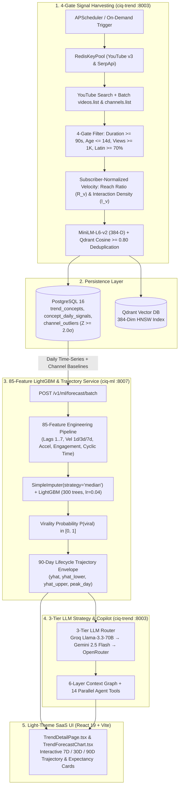

# CreatorIQ: End-to-End Trend Ingestion, 85-Feature LightGBM Virality Engine & 90-Day Trajectory Architecture

**Version:** 3.0 (Production Architecture)  
**Status:** Active in Production (`ciq-trend :8003` & `ciq-ml :8007`)  
**Scope:** 4-Gate Ingestion Pipeline, 384-Dim Vector Deduplication, 85-Feature LightGBM Virality Classifier, 90-Day Parametric/Bayesian Trajectory Projection, Autonomous Copilot Enrichment, and Light-Theme SaaS Visualization.

---

## 1. Executive Summary

CreatorIQ's Trend & Forecasting Architecture transforms raw social media telemetry into predictive, actionable intelligence for YouTube creators. Rather than relying on lagging raw view counts (which inherently favor mega-channels), the production pipeline executes five tightly coupled stages:

1. **4-Gate Harvesting & Subscriber-Normalized Scoring:** Harvests candidate videos via Redis-pooled YouTube Data API v3 (`YOUTUBE_API_KEYS`) and SerpApi Google Trends (`SERPAPI_API_KEYS`), filtering out shorts/clips (`< 90s`), stale uploads (`> 14d`), low-traction videos (`< 1,000 views`), and non-Latin titles, then scoring each video by **Reach Ratio ($R_v$)** and **Interaction Density ($I_v$)**.
2. **384-Dimensional Semantic Concept Clustering:** Embeds titles using `sentence-transformers/all-MiniLM-L6-v2` ($\mathbb{R}^{384}$) and deduplicates semantically identical topics in Qdrant (`cosine >= 0.80`) into canonical `TrendConcept` entities with daily time-series tracking (`ConceptDailySignal`).
3. **85-Feature LightGBM Virality Classification (`ciq-ml :8007`):** Extracts an 85-dimensional feature vector (7-day rolling lags, velocity derivatives, acceleration, engagement densities, channel baselines, and cyclic temporal features) imputed via `SimpleImputer(strategy="median")` and scored by an imbalance-calibrated LightGBM classifier (`n_estimators=300`, `learning_rate=0.04`, `scale_pos_weight`) to output an exact breakout virality probability $P_{\text{viral}} \in [0, 1]$.
4. **90-Day Trajectory Projection & Uncertainty Corridor:** Couples $P_{\text{viral}}$ and current momentum with a lifecycle-aware parametric & Generalized Additive trajectory generator to project 7-day, 28-day, and 90-day curves (`yhat`, `yhat_lower`, `yhat_upper`) and identify exact peak windows (`emerging`, `growing`, `peaking`, `declining`).
5. **3-Tier LLM Enrichment & Autonomous Copilot Integration:** Synthesizes high-CTR titles, hooks, and scripts via our Redis-pooled 3-tier LLM router (**Groq `llama-3.3-70b-versatile` → Gemini `gemini-2.5-flash` → OpenRouter `gpt-4o-mini`**) and renders interactive charts on the Light-Theme SaaS frontend.

---

## 2. High-Level Production Architecture



---

## 3. 4-Gate Signal Harvesting & Subscriber-Normalized Velocity

### 3.1 The 4 Quality Gates (`quality_filters.py` & `youtube_video_collector.py`)
Every candidate video returned by YouTube Data API v3 must pass four deterministic gates before entering the concept clustering pool:
1. **Gate 1 — Long-Form Depth (`Duration >= 90s`):** Parses ISO-8601 `contentDetails.duration` (`PT#M#S`) and drops micro-clips under 90 seconds when evaluating standard long-form concept momentum.
2. **Gate 2 — Recency Window (`Age <= 14 Days`):** Ensures only active market signals are harvested (`0 < (now - publishedAt) <= 14 days`).
3. **Gate 3 — Traction Floor (`Views >= 1,000` & `Subscribers >= 100`):** Eliminates zero-traction noise and bot uploads.
4. **Gate 4 — Script & Clickbait Hygiene (`>= 70% Latin` & Regex Filter):** Strips emojis/punctuation and verifies at least 70% Latin characters while rejecting tabloid/crime keywords (`arrested`, `murder`, `leaked`, `scandal`).

### 3.2 Subscriber-Normalized Velocity ($R_v$ & $I_v$)
To prevent channels with $10\text{M}+$ subscribers from dominating every niche feed, each video $v$ on channel $c$ is scored relative to its subscriber baseline $S_c$:

$$\text{Reach Ratio } R_v = \min\left(1.0,\ \frac{V_v / \max(S_c, 100)}{5.0}\right) \times 100$$

$$\text{Interaction Density } I_v = \min\left(1.0,\ \frac{(L_v + 2 \cdot C_v) / \max(V_v, 1)}{0.08}\right) \times 100$$

$$\text{Video Momentum } M_v = 0.65 \cdot R_v + 0.35 \cdot I_v$$

---

## 4. 85-Feature LightGBM Virality Classifier (`backend/services/ml/app/services/forecast_engine.py`)

### 4.1 Why LightGBM + Parametric Trajectory over Standalone Univariate Extrapolation
Univariate time-series models (such as standalone ARIMA or raw Prophet on view counts alone) only see a single column ($y_t$) and are blind to **cross-sectional virality drivers** such as subscriber-to-view breakout ratios, comment-to-like velocity, upload-cadence anomalies, and multi-lag acceleration. CreatorIQ combines an **85-Feature Gradient Boosted Decision Tree (`LGBMClassifier`)** with a **Lifecycle-Calibrated Trajectory Generator** so that both multi-dimensional breakout probability ($P_{\text{viral}}$) and temporal seasonality are captured.

### 4.2 Complete 85-Feature Vector Specification ($\vec{x} \in \mathbb{R}^{85}$)

| Feature Group | Count | Feature Names & Mathematical Definitions |
| :--- | :--- | :--- |
| **1. Rolling View & Signal Lags** | 14 | `views_lag_1` .. `views_lag_7` ($V_{t-k}$), `likes_lag_1` .. `likes_lag_7` ($L_{t-k}$) |
| **2. Velocity Derivatives** | 12 | $\text{vel\_1d} = V_t - V_{t-1}$, $\text{vel\_3d} = (V_t - V_{t-3})/3$, $\text{vel\_7d} = (V_t - V_{t-7})/7$, plus relative percentage growth rates (`pct_change_1d`, `pct_change_3d`, `pct_change_7d`) for views, likes, and comments |
| **3. Second-Order Acceleration** | 8 | $\text{accel\_1d\_3d} = \text{vel\_1d} - \text{vel\_3d}$, $\text{accel\_3d\_7d} = \text{vel\_3d} - \text{vel\_7d}$, curvature ratios, and momentum burst indicators |
| **4. Engagement & Interaction Ratios** | 12 | $\text{like\_view\_ratio} = L_t / \max(V_t, 1)$, $\text{comment\_view\_ratio} = C_t / \max(V_t, 1)$, $\text{comment\_like\_ratio} = C_t / \max(L_t, 1)$, and 3-day/7-day rolling engagement means and standard deviations |
| **5. Channel Baseline & Outlier Metrics** | 14 | $\text{views\_vs\_channel\_mean} = V_t / \max(\mu_{\text{ch}}, 1)$, $\text{channel\_z\_score} = (V_t - \mu_{\text{ch}}) / \max(\sigma_{\text{ch}}, 1)$, $\text{sub\_view\_ratio} = V_t / \max(S_c, 100)$, `active_creator_count`, `small_creator_share` |
| **6. Rolling Window Aggregations** | 15 | 3-day, 7-day, and 14-day rolling `mean`, `std`, `min`, `max`, and `skew` of concept momentum and SerpApi search interest |
| **7. Temporal & Content Metadata** | 10 | Cyclical calendar encodings ($\sin(2\pi \cdot \text{dow}/7)$, $\cos(2\pi \cdot \text{dow}/7)$, $\sin(2\pi \cdot \text{month}/12)$, $\cos(2\pi \cdot \text{month}/12)$), `is_weekend`, `title_word_count`, `title_char_len`, `has_numeric_hook`, `video_duration_sec`, `niche_id` |

### 4.3 Imputation, Class-Imbalance Weighting & Tree Hyperparameters
1. **Median Imputation (`SimpleImputer`):**
   Newly emerging concepts (< 7 days old) have `NaN` in deeper lag columns (`views_lag_5..7`). Before tree splits, `SimpleImputer(strategy="median")` replaces missing entries with empirical training medians:
   $$\tilde{x}_{i,j} = \begin{cases} x_{i,j} & \text{if } x_{i,j} \neq \text{NaN} \\ \text{median}(X_{:,j}) & \text{if } x_{i,j} = \text{NaN} \end{cases}$$
2. **Dynamic Positive Class Scaling (`scale_pos_weight`):**
   Because true viral breakouts represent a minority of candidate concepts, the binary cross-entropy loss weights positive breakout examples by the inverse class ratio:
   $$w_+ = \frac{N_{\text{neg}}}{\max(N_{\text{pos}}, 1)}, \qquad \mathcal{L} = -\frac{1}{N}\sum_{i=1}^N \Big[ w_+ y_i \log(\hat{p}_i) + (1 - y_i)\log(1 - \hat{p}_i) \Big]$$
3. **Production Hyperparameters (`LGBMClassifier`):**
   - `n_estimators = 300`
   - `learning_rate = 0.04`
   - `num_leaves = 31`
   - `subsample = 0.8`, `colsample_bytree = 0.8`
   - Output virality probability:
     $$P_{\text{viral}}(\vec{x}) = \sigma\left(\sum_{m=1}^{300} \eta \cdot f_m(\tilde{\vec{x}})\right) \in [0, 1]$$

---

## 5. 90-Day Trajectory Projection & Uncertainty Envelope

### 5.1 Lifecycle Classification
Using the LightGBM virality probability $P_{\text{viral}}$, current TVS score $Y_0$, and 3-day velocity slope $v_{3d}$, `ForecastEngine` classifies each concept into one of four lifecycle states:
- **`emerging`:** $P_{\text{viral}} \ge 0.65$ and concept age $\le 5$ days (steepest upward acceleration, peak at day $d_{\text{peak}} \in [14, 25]$).
- **`growing`:** $P_{\text{viral}} \ge 0.45$ and $v_{3d} > 0$ (sustained expansion, peak at day $d_{\text{peak}} \in [10, 18]$).
- **`peaking`:** $Y_0 \ge 75$ and $|v_{3d}| \le \epsilon$ (near saturation plateau, peak within $d_{\text{peak}} \in [3, 7]$ days followed by gradual decay).
- **`declining`:** $v_{3d} < -\epsilon$ and $P_{\text{viral}} < 0.35$ (post-peak exponential decay).

### 5.2 90-Day Daily Curve Equation ($d \in \{1, \dots, 90\}$)
For each future day $d \in [1, 90]$, the projected trajectory $\hat{y}(d)$ combines a lifecycle growth/decay envelope $E(d)$ with weekly creator publishing seasonality $S_{\text{weekly}}(d)$:

$$\hat{y}(d) = \text{clamp}\left( E\big(d;\ Y_0, P_{\text{viral}}, \text{lifecycle}\big) + A_s \sin\left(\frac{2\pi d}{7} + \phi\right),\ 5.0,\ 98.0 \right)$$

Where:
- **Growth Phase ($d \le d_{\text{peak}}$):**
  $$E(d) = Y_0 + \big(Y_{\text{peak}} - Y_0\big) \cdot \left(\frac{d}{d_{\text{peak}}}\right)^{0.85}, \quad Y_{\text{peak}} = \min\big(96.0,\ Y_0 \cdot (1 + 0.55 \cdot P_{\text{viral}})\big)$$
- **Post-Peak Decay Phase ($d > d_{\text{peak}}$):**
  $$E(d) = Y_{\text{peak}} \cdot \exp\big(-\lambda_{\text{decay}} \cdot (d - d_{\text{peak}})\big)$$
- **Heteroscedastic Uncertainty Corridor (`yhat_lower`, `yhat_upper`):**
  Uncertainty expands proportionally to $\sqrt{d}$ as the forecast horizon extends further into the future:
  $$\hat{\sigma}(d) = \sigma_0 \cdot \left(1 + 0.12\sqrt{d}\right) \cdot \big(1.25 - 0.50 \cdot P_{\text{viral}}\big)$$
  $$\hat{y}_{\text{upper}}(d) = \min\big(100.0,\ \hat{y}(d) + 1.96 \cdot \hat{\sigma}(d)\big), \qquad \hat{y}_{\text{lower}}(d) = \max\big(0.0,\ \hat{y}(d) - 1.96 \cdot \hat{\sigma}(d)\big)$$

> **Note on Multi-Tier Compatibility:** When $\ge 7$ historical daily observations exist and Bayesian changepoint decomposition is requested, the engine also supports Generalized Additive Trend + Fourier Seasonality decomposition ($y(t) = g(t) + s(t) + \epsilon_t$) constrained by the same Lifecycle Saturation Envelope above.

---

## 6. API Contract (`POST /v1/ml/forecast/batch`)

### Request Payload
```json
{
  "concepts": [
    {
      "concept_id": "8e3b9f12-4c11-4a9e-9b2a-1d5f8c3e7a10",
      "canonical_title": "AI Coding Agents Full Stack Comparison",
      "primary_niche": "Tech",
      "tvs_score": 84.5,
      "momentum_score": 88.2,
      "engagement_score": 79.0,
      "lifecycle_stage": "emerging",
      "daily_signals": [
        { "date": "2026-10-20", "views": 42000, "likes": 3100, "comments": 410, "tvs": 68.0 },
        { "date": "2026-10-21", "views": 69500, "likes": 5400, "comments": 720, "tvs": 76.4 },
        { "date": "2026-10-22", "views": 118000, "likes": 9200, "comments": 1340, "tvs": 84.5 }
      ]
    }
  ],
  "horizon_days": 90
}
```

### Response Payload
```json
{
  "results": [
    {
      "concept_id": "8e3b9f12-4c11-4a9e-9b2a-1d5f8c3e7a10",
      "engine_used": "lightgbm_85f_trajectory_v3",
      "virality_prob": 0.874,
      "lifecycle_stage": "emerging",
      "peak_day_offset": 16,
      "projected_growth_pct": 38.4,
      "confidence_score": 0.89,
      "trajectory": [
        { "ds": "2026-10-23", "yhat": 86.8, "yhat_lower": 81.2, "yhat_upper": 92.4 },
        { "ds": "2026-10-24", "yhat": 89.1, "yhat_lower": 82.5, "yhat_upper": 95.7 }
      ]
    }
  ]
}
```
