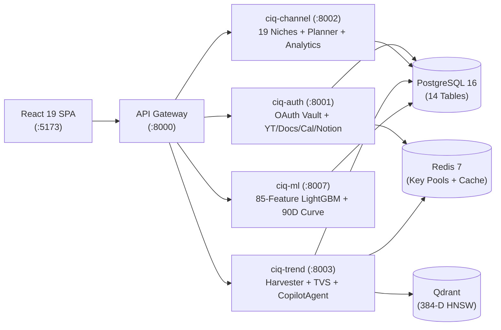

# CreatorIQ: Technical Viva & System Architecture Defense Guide (v3.0)

**Target Audience:** Senior Technical Interviewers, ML Architects, Distributed Systems Evaluators, and Academic/Industry Viva Panels  
**Scope:** 5-Microservice Architecture, Redis Multi-Key Pool Rotation (`RedisKeyPool`), 3-Tier LLM Router (`Groq -> Gemini -> OpenRouter`), 4-Gate Signal Harvesting, Subscriber-Normalized Velocity ($R_v, I_v$), 384-Dim MiniLM + Qdrant HNSW, 85-Feature LightGBM Virality Classifier (`SimpleImputer`, `scale_pos_weight`), 90-Day Trajectory Engine, Autonomous `CopilotAgent` with Parallel `asyncio.gather`, and 4 OAuth Workspace Connectors with Measured YouTube Analytics API v2 Retention.

---

## Table of Contents
1. [System Architecture & Microservice Consolidation](#1-system-architecture--microservice-consolidation)
2. [Zero-SPOF Redis Key Pool & 3-Tier LLM Router](#2-zero-spof-redis-key-pool--3-tier-llm-router)
3. [4-Gate Ingestion Pipeline & Subscriber-Normalized Velocity](#3-4-gate-ingestion-pipeline--subscriber-normalized-velocity)
4. [Vector Embeddings & Qdrant HNSW Clustering](#4-vector-embeddings--qdrant-hnsw-clustering)
5. [Multi-Attribute TVS & $2\sigma$ Breakout Outlier Detection](#5-multi-attribute-tvs--2sigma-breakout-outlier-detection)
6. [85-Feature LightGBM Virality Classifier & 90-Day Trajectory Engine](#6-85-feature-lightgbm-virality-classifier--90-day-trajectory-engine)
7. [Autonomous `CopilotAgent`, 6-Layer Context & Parallel Tool Execution](#7-autonomous-copilotagent-6-layer-context--parallel-tool-execution)
8. [4 OAuth Workspace Connectors & Measured YouTube Retention](#8-4-oauth-workspace-connectors--measured-youtube-retention)
9. [Interviewer "Trap" Questions & Rapid-Fire Defense](#9-interviewer-trap-questions--rapid-fire-defense)
10. [Quick Reference Summary Matrix](#10-quick-reference-summary-matrix)

---

## 1. System Architecture & Microservice Consolidation

### Q1.1: Why does CreatorIQ run 5 distinct backend microservices (`:8000`, `:8001`, `:8002`, `:8003`, `:8007`), and why was the Strategy Copilot unified into `ciq-trend (:8003)`?
**Defense:**
> 1. **Compute & Dependency Isolation (`ciq-ml :8007`):** The ML service runs CPU-bound numerical workloads (`lightgbm`, `scikit-learn`, `numpy`, `pandas`, `scipy`). Isolating `:8007` ensures that batch 85-feature extraction and tree inference never block the asynchronous FastAPI event loop serving real-time SSE chat streams or OAuth handshakes.
> 2. **Security Boundary Isolation (`ciq-auth :8001`):** Only `ciq-auth` holds the `AES_ENCRYPTION_KEY` (Fernet) and RSA private key (`jwt-private.pem`) required to decrypt OAuth refresh tokens and sign JWTs. Even if another service were compromised, raw OAuth credentials cannot be extracted.
> 3. **Co-Location of `CopilotAgent` and Trend Radar (`ciq-trend :8003`):** During a single user prompt, `CopilotAgent` frequently queries `TrendConcept`, `ConceptDailySignal`, `ChannelOutlier`, and `SavedTrend`. Co-locating the Copilot agent and its 14 tools inside `ciq-trend` eliminates serial HTTP serialization overhead for database-heavy tools while delegating ML inference (`:8007`) and OAuth workspace execution (`:8001`) via parallel async RPC.

### Q1.2: How is authentication enforced at the edge and across internal services?
**Defense:**
> - **Asymmetric RS256 JWTs:** `ciq-auth` signs tokens with a 2048-bit RSA private key (`ACCESS_TOKEN_EXPIRE_MINUTES = 10080` / 7 days; refresh token = 30 days). `ciq-api-gateway` verifies signatures using only the public key (`jwt-public.pem`), strips any spoofed `X-User-Id` headers from incoming traffic, and injects the verified `X-User-Id`.
> - **Internal Service Token:** Service-to-service RPC calls require `X-Internal-Service-Token: <shared_secret>`, preventing unauthorized lateral calls.

---

## 2. Zero-SPOF Redis Key Pool & 3-Tier LLM Router

### Q2.1: External APIs (YouTube Data API v3, SerpApi, Groq, Gemini) enforce strict rate limits (`429` / `403 quotaExceeded`). How does CreatorIQ guarantee 100% uptime under heavy usage?
**Defense:**
> We built an atomic, distributed **`RedisKeyPool`** (`backend/services/trend/app/core/key_pool.py`) backing all 6 external providers (`youtube`, `serpapi`, `tavily`, `groq`, `gemini`, `openrouter`):
> 1. **Atomic Round-Robin Selection:** Every call executes `idx = INCR creatoriq:keypool:{pool_name}:idx` in Redis and selects $k = \mathcal{K}[\text{idx} \bmod N]$.
> 2. **Scoped SHA-256 Cooldown Quarantine:** If key $k$ returns HTTP `429` or `403`, we compute $h = \text{SHA256}(k)[0:12]$ and execute:
>    $$\text{SETEX } \texttt{creatoriq:keypool:\{pool\}:cooldown:\{h\}} \quad T_{\text{cooldown}} \quad \text{"1"}$$
>    (`90s` for LLMs, `1800s` for Tavily, `3600s` for YouTube/SerpApi). Subsequent calls check `EXISTS` and automatically skip quarantined keys.
> 3. **3-Tier Multi-Provider LLM Failover (`llm_router.py`):**
>    - **Tier 1:** Groq LPU (`llama-3.3-70b-versatile`) — ~300 tokens/sec primary inference.
>    - **Tier 2:** Google Gemini (`gemini-2.5-flash`) — Automatic schema translator converts OpenAI `tools` JSON Schema into Gemini's native `functionDeclarations` and maps `functionCall` responses back seamlessly.
>    - **Tier 3:** OpenRouter (`openai/gpt-4o-mini`) — Final fallback guarantee.

---

## 3. 4-Gate Ingestion Pipeline & Subscriber-Normalized Velocity

### Q3.1: Why is raw view count a flawed metric for trend discovery, and how does your mathematical formulation solve it?
**Defense:**
> Raw view count measures **channel distribution power**, not **topic virality**. If a 10M-subscriber channel uploads a mediocre video that gets 150K views, raw view sorting ranks it above a 2,000-subscriber channel whose video on a new AI tool just hit 80K views ($40\times$ breakout).
>
> We solve this in two ways:
> 1. **4-Gate Signal Filter:** Rejects shorts/clips (`< 90s`), stale videos (`> 14 days`), dead uploads (`< 1,000 views`), and non-Latin scripts (`< 70% Latin`).
> 2. **Subscriber-Normalized Reach Ratio ($R_v$) & Interaction Density ($I_v$):**
>    $$R_v = \min\left(1.0,\ \frac{V_v / \max(S_c, 100)}{5.0}\right) \times 100, \qquad I_v = \min\left(1.0,\ \frac{(L_v + 2C_v)/V_v}{0.08}\right) \times 100$$
>    $$M_v = 0.65 \cdot R_v + 0.35 \cdot I_v$$
>    A video achieving $5\times$ its channel's subscriber count saturates $R_v = 100$, immediately surfacing grassroots breakouts.

---

## 4. Vector Embeddings & Qdrant HNSW Clustering

### Q4.1: How does CreatorIQ group dozens of differently worded YouTube videos into a single canonical `TrendConcept`?
**Defense:**
> 1. **Model Choice:** We use `sentence-transformers/all-MiniLM-L6-v2` ($\mathbb{R}^{384}$, $L_2$-normalized) loaded as an in-memory singleton (`vector_service.py`), achieving $< 15\text{ms}$ CPU embedding latency with zero external API cost.
> 2. **Cosine Deduplication in Qdrant:** When a new video title is harvested, we query the Qdrant HNSW index within the same `primary_niche`. If the nearest concept anchor $c^*$ satisfies:
>    $$\cos(\hat{e}_v, \hat{e}_{c^*}) = \hat{e}_v \cdot \hat{e}_{c^*} \ge 0.80$$
>    the video is merged into concept $c^*$ and updates today's `ConceptDailySignal` row; otherwise, a new `TrendConcept` and Qdrant point are created.

---

## 5. Multi-Attribute TVS & $2\sigma$ Breakout Outlier Detection

### Q5.1: How are `TrendVelocityScore` (TVS) and `ChannelOutlier` ($Z$-score) calculated?
**Defense:**
> 1. **Trend Velocity Score ($\text{TVS}_c \in [0, 100]$):**
>    $$\text{TVS}_c = \text{round}\Big(\text{clamp}\big(0.60 \cdot \bar{M}_c + 0.40 \cdot E_{\text{raw}}(c) + \Delta_{\text{accel}}(c),\ 0,\ 100\big),\ 1\Big)$$
>    where $\Delta_{\text{accel}}(c) \in [-15, +20]$ rewards day-over-day velocity acceleration.
> 2. **$2\sigma$ Channel Outlier Detection (`ChannelOutlier`):**
>    For each channel's recent upload baseline ($\mu_{\text{ch}}, \sigma_{\text{ch}}$):
>    $$Z_v = \frac{V_v - \mu_{\text{ch}}}{\max(\sigma_{\text{ch}}, 1.0)}, \qquad \text{Multiplier}_v = \frac{V_v}{\max(\mu_{\text{ch}}, 1.0)}$$
>    Any video with $Z_v \ge 2.0$ and $\text{Multiplier}_v \ge 2.5\times$ is persisted to `channel_outliers` linked to its `concept_id` and `primary_niche`.

---

## 6. 85-Feature LightGBM Virality Classifier & 90-Day Trajectory Engine

### Q6.1: Walk through the architecture of `ForecastEngine` (`ciq-ml :8007`). Why did you engineer an 85-Feature LightGBM Classifier paired with a 90-Day Trajectory Envelope?
**Defense:**
> Univariate extrapolation alone cannot tell whether a 2-day spike is a sustainable viral trend or clickbait decay because it ignores engagement density, subscriber-to-view ratios, and multi-lag acceleration.
> 1. **85 Engineered Features ($\vec{x} \in \mathbb{R}^{85}$):**
>    - **Lags (14):** 7-day rolling view and like lags (`views_lag_1..7`, `likes_lag_1..7`).
>    - **Velocity Derivatives (12):** 1d, 3d, and 7d finite differences and percentage growth rates.
>    - **Second-Order Acceleration (8):** `accel_1d_3d = vel_1d - vel_3d`, `accel_3d_7d = vel_3d - vel_7d`.
>    - **Engagement Densities (12):** `like_view_ratio`, `comment_view_ratio`, `comment_like_ratio`, and rolling variances.
>    - **Channel Baselines (14):** `views_vs_channel_mean`, `channel_z_score`, `sub_view_ratio`, `small_creator_share`.
>    - **Rolling Aggregations (15) & Cyclic Temporal Features (10):** 3d/7d/14d `mean`/`std`/`skew` + $\sin/\cos$ day-of-week and month encodings.
> 2. **Imputation & Imbalance Calibration:**
>    - `SimpleImputer(strategy="median")` handles `NaN` lags on newly discovered concepts (< 7 days old).
>    - `scale_pos_weight = N_neg / max(N_pos, 1)` weights the binary cross-entropy loss so rare viral breakouts are not drowned out by non-viral concepts.
>    - Trained with `n_estimators = 300`, `learning_rate = 0.04`, `num_leaves = 31`.
> 3. **90-Day Lifecycle Trajectory Projection:**
>    - Combines $P_{\text{viral}} \in [0, 1]$ and current TVS $Y_0$ to project a 90-day daily curve (`yhat`, `yhat_lower`, `yhat_upper`) with heteroscedastic uncertainty $\hat{\sigma}(d) \propto \sqrt{d}$ and weekly Fourier seasonality.

---

## 7. Autonomous `CopilotAgent`, 6-Layer Context & Parallel Tool Execution

### Q7.1: How does `CopilotAgent` achieve deep personalization and low latency when invoking multiple tools in a single turn?
**Defense:**
> 1. **6-Layer Living Creator Context Graph:** Every prompt is hydrated with:
>    - **Layer 1:** Creator Profile & Channel Baseline (subscribers, $\mu_{\text{ch}}$, engagement rate, and measured `avg_retention_pct`).
>    - **Layer 2:** Long-Term `CreatorMemory` facts (`preference`, `constraint`, `audience_insight`, `past_decision`, `style_rule`) extracted silently in the background after each chat turn.
>    - **Layer 3:** Recent uploads & $2\sigma$ channel outliers.
>    - **Layer 4:** Live Top-5 Niche Radar (`TrendConcept`).
>    - **Layer 5:** Bookmarked trends (`SavedTrend` joining both `TrendConcept` and legacy `Trend`) & recent session summaries.
>    - **Layer 6:** Live OAuth Connector statuses + any attached `TrendContextPayload` from `TrendDetailPage.tsx`.
> 2. **Parallel `asyncio.gather` with Isolated DB Sessions:**
>    When the LLM emits $K$ tool calls in one turn, executing them sequentially would sum their latencies. However, sharing a single SQLAlchemy `Session` across concurrent coroutines causes transaction state corruption. Our `_run_single_tool` wrapper instantiates a dedicated `SessionLocal()` inside a `try/finally` block per coroutine and runs all $K$ tools concurrently via `asyncio.gather`, cutting multi-tool latency from $\sum T_i$ to $\max T_i$.

---

## 8. 4 OAuth Workspace Connectors & Measured YouTube Retention

### Q8.1: How does the 3-Unit YouTube Deep Sync work, and how do you measure audience retention honestly?
**Defense:**
> 1. **3-Unit YouTube Data API v3 Sync (`youtube_client.py`):**
>    Instead of calling `search.list` (`100 quota units`), we derive the channel's uploads playlist ID (`UC...` $\to$ `UU...`) and execute:
>    - `channels.list` (`1 unit`) + `playlistItems.list` (`1 unit`) + batched `videos.list` for 50 video IDs (`1 unit`) = **3 quota units total** (a $97\%$ quota reduction).
> 2. **Measured Retention via YouTube Analytics API v2 (`youtube_analytics_client.py`):**
>    We never fabricate retention from engagement heuristics. Using the `yt-analytics.readonly` scope, we query `https://youtubeanalytics.googleapis.com/v2/reports` for `metrics=averageViewPercentage,averageViewDuration`. If the creator has not granted Analytics permission or has no watch-time data, `avg_retention_pct` is stored strictly as `None` (`N/A` in UI).
> 3. **Fernet AES-128-CBC + HMAC Token Vault:**
>    All OAuth tokens for `youtube`, `google_docs`, `google_calendar`, and `notion` are encrypted at rest in `oauth_connections` using `cryptography.fernet.Fernet` and automatically refreshed when within 5 minutes of `expires_at`.

---

## 9. Interviewer "Trap" Questions & Rapid-Fire Defense

### Trap 1: "What happens if a user saves a modern `TrendConcept` vs. a legacy `Trend` record? Doesn't a standard INNER JOIN drop their saved trends?"
> **Defense:**
> *"We use a dual-entity `outerjoin` on `SavedTrend` (`outerjoin(Trend, SavedTrend.trend_id == Trend.id)` and `outerjoin(TrendConcept, SavedTrend.concept_id == TrendConcept.id)`) in both `strategy_service.py` and `tool_registry.py`. Whichever foreign key is populated resolves cleanly via `COALESCE`-style fallback (`concept.canonical_title` or `trend.topic`), ensuring zero data loss across schema versions."*

### Trap 2: "Why not use a single shared SQLAlchemy session for parallel tool calls in `asyncio.gather`?"
> **Defense:**
> *"SQLAlchemy `Session` objects are stateful unit-of-work containers and are **not** coroutine-safe for concurrent queries. Running two concurrent queries on the same session raises `InvalidRequestError: This session is provisioning a new connection; concurrent operations are not permitted`. By creating an isolated `SessionLocal()` inside each tool task's `try / finally` block, every parallel tool gets its own pooled connection from `QueuePool` and closes it deterministically."*

---

## 10. Quick Reference Summary Matrix

| Subsystem | Production Implementation | Primary File | Key Parameters / Equations |
| :--- | :--- | :--- | :--- |
| **API Key Rotation** | Atomic Redis Round-Robin + Cooldown | `trend/app/core/key_pool.py` | `INCR idx`, `SETEX cooldown:{sha256_12}` |
| **LLM Routing** | 3-Tier Multi-Provider Failover | `trend/app/core/llm_router.py` | Groq `llama-3.3-70b-versatile` $\to$ Gemini `gemini-2.5-flash` $\to$ OpenRouter |
| **Signal Harvesting** | 4-Gate Filter + Subscriber Normalization | `youtube_video_collector.py` | $\ge 90\text{s}$, $\le 14\text{d}$, $\ge 1\text{K views}$, $M_v = 0.65 R_v + 0.35 I_v$ |
| **Vector Clustering** | `all-MiniLM-L6-v2` + Qdrant HNSW | `vector_service.py` | 384-Dim Cosine Similarity $\ge 0.80$ |
| **Outlier Detection** | $2\sigma$ Channel Baseline Filter | `scoring.py` | $Z_v = (V_v - \mu_{\text{ch}})/\sigma_{\text{ch}} \ge 2.0$, Multiplier $\ge 2.5\times$ |
| **Virality ML Model** | 85-Feature LightGBM Classifier | `ml/app/services/forecast_engine.py` | 300 trees, `lr=0.04`, `SimpleImputer(median)`, `scale_pos_weight` |
| **Trajectory Curve** | 90-Day Lifecycle Envelope + Credible Bands | `ml/app/services/forecast_engine.py` | `emerging` / `growing` / `peaking` / `declining`, $\hat{y} \pm 1.96\hat{\sigma}(d)$ |
| **Copilot Agent** | 6-Layer Context + 14 Parallel Tools | `trend/app/agent/copilot_agent.py` | `asyncio.gather` with isolated `SessionLocal()` + `CreatorMemory` |
| **OAuth Connectors** | YouTube, Docs, Calendar, Notion | `auth/app/api/v1/endpoints/connectors.py` | Fernet AES-128-CBC + 3-Unit YT Sync + YT Analytics v2 Retention |
