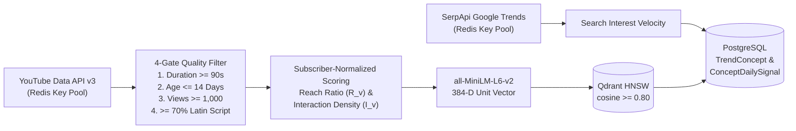

# CreatorIQ Trends Engine — Production Technical Specification (v3.0)

**Version:** 3.0  
**Status:** Active in Production (`ciq-trend :8003` & `ciq-ml :8007`)  
**Depends on:** 7-Step Onboarding & 3-Unit YouTube OAuth Deep Sync (`ciq-auth :8001`), Qdrant Vector Service, and 85-Feature LightGBM Engine (`ciq-ml :8007`).

---

## 1. Product Definition & Core Principles

CreatorIQ Trends Engine is a **personalized, evidence-backed Content Opportunity Radar** that helps YouTube creators identify high-velocity topics tailored to their exact niche, channel size, format, and target geography.

| Principle | Production Implementation |
| :--- | :--- |
| **Primary Feed Output** | Curated **Top-5 Personalized Opportunities** + Full Niche Radar & $2\sigma$ Outlier Feed |
| **Primary Signal** | **Subscriber-Normalized YouTube Velocity ($R_v, I_v$)** corroborated by **SerpApi Google Trends** |
| **Concept Deduplication** | **384-Dim `all-MiniLM-L6-v2` + Qdrant HNSW** (`cosine >= 0.80` clusters videos into `TrendConcept`) |
| **Breakout Detection** | **$2\sigma$ Channel Outlier Engine** ($Z_v = (V_v - \mu_{\text{ch}}) / \sigma_{\text{ch}} \ge 2.0$) |
| **Predictive Trajectory** | **85-Feature LightGBM Virality Classifier (`P(viral)`) + 90-Day Trajectory Curve** (`:8007`) |
| **Quota Resiliency** | **Atomic Redis Multi-Key Pool (`RedisKeyPool`)** across YouTube Data v3, SerpApi, Tavily, Groq, Gemini & OpenRouter |
| **UI Architecture** | **Strict Light-Theme SaaS Design System** (`#FBFAF8` canvas, `#FFFFFF` cards, `#FF98C1` primary actions) |

---

## 2. Multi-Source Data Ingestion & 4-Gate Filtering

### 2.1 The 4 Quality Gates
Every harvested video $v$ is evaluated against four hard gates before clustering:
1. **Duration Gate:** $\text{duration}(v) \ge 90\text{ seconds}$ (separates substantial long-form concepts from micro-clips).
2. **Freshness Gate:** $0 < (t_{\text{now}} - t_{\text{published}}(v)) \le 14\text{ days}$.
3. **Traction Gate:** $V_v \ge 1,000\text{ views}$ and channel subscribers $S_c \ge 100$.
4. **Linguistic & Safety Gate:** $\ge 70\%$ Latin script characters and zero matches against the tabloid/scandal exclusion regex.

---

## 3. Mathematical Scoring Model

### 3.1 Per-Video Subscriber-Normalized Momentum ($M_v$)
To ensure a $5,000$-subscriber channel pulling $50,000$ views ($10\times$ breakout) ranks higher than a $5\text{M}$-subscriber channel pulling $100,000$ views ($0.02\times$ underperformance):

$$R_v = \text{clamp}\left(\frac{V_v / \max(S_c, 100)}{5.0},\ 0.0,\ 1.0\right) \times 100$$

$$I_v = \text{clamp}\left(\frac{(L_v + 2 \cdot C_v) / \max(V_v, 1)}{0.08},\ 0.0,\ 1.0\right) \times 100$$

$$M_v = 0.65 \cdot R_v + 0.35 \cdot I_v$$

### 3.2 Concept-Level Trend Velocity Score ($\text{TVS}_c \in [0, 100]$)
For a `TrendConcept` $c$ aggregating cluster videos $\mathcal{V}_c$:

$$\bar{M}_c = \frac{1}{|\mathcal{V}_c|} \sum_{v \in \mathcal{V}_c} M_v, \qquad E_{\text{raw}}(c) = \frac{1}{|\mathcal{V}_c|} \sum_{v \in \mathcal{V}_c} I_v$$

$$\Delta_{\text{accel}}(c) = \text{clamp}\left(\frac{\bar{M}_{c,t} - \bar{M}_{c,t-1}}{\max(\bar{M}_{c,t-1}, 1.0)} \times 25.0,\ -15.0,\ +20.0\right)$$

$$\text{TVS}_c = \text{round}\Big(\text{clamp}\big(0.60 \cdot \bar{M}_c + 0.40 \cdot E_{\text{raw}}(c) + \Delta_{\text{accel}}(c),\ 0.0,\ 100.0\big),\ 1\Big)$$

### 3.3 Personalized Creator Opportunity Score
When ranking concepts for a specific creator profile (`primary_niche`, `target_region`, `content_format`):

$$\text{OpportunityScore}(u, c) = \text{clamp}\Big(0.50 \cdot \text{TVS}_c + 25.0 \cdot \text{NicheFit}(u, c) + 20.0 \cdot \text{GeoFit}(u, c) + 5.0 \cdot \text{FormatFit}(u, c) + B_{\text{vec}} + B_{\text{outlier}},\ 0,\ 100\Big)$$

- **Vector Boost ($B_{\text{vec}}$):** $+15.0 \times \cos(\hat{e}_u, \hat{e}_c)$ when Qdrant cosine similarity $\ge 0.50$.
- **Outlier Boost ($B_{\text{outlier}}$):** $+8.0$ points when the concept includes a $2\sigma$ channel outlier ($Z_v \ge 2.0$).

---

## 4. 19 Canonical Creator Niches

CreatorIQ normalizes all channel profiles, onboarding selections, and concept clusters across 19 canonical niches:
1. `Tech & AI`
2. `Gaming`
3. `Personal Finance & Investing`
4. `Business & Entrepreneurship`
5. `Health & Fitness`
6. `Education & Science`
7. `Coding & Software Engineering`
8. `Entertainment & Pop Culture`
9. `Lifestyle & Vlogs`
10. `Food & Cooking`
11. `Travel & Adventure`
12. `Beauty & Fashion`
13. `Music & Audio Production`
14. `Sports & Athletics`
15. `Self-Improvement & Productivity`
16. `Cars & Automotive`
17. `Art, Design & Animation`
18. `Photography & Filmmaking`
19. `History, Geopolitics & Documentary`

---

## 5. Seamless Handoff to Strategy Copilot (`/app/strategy`)

Clicking **"Generate Strategy"** on any Trend Card or on `TrendDetailPage.tsx` packages the complete `TrendContextPayload` (`concept_id`, `canonical_title`, `tvs_score`, `lifecycle_stage`, `virality_prob`, `why_trending`, `suggested_angle`, `evidence_videos`) into `useStrategyStore` and opens `/app/strategy`. The `CopilotAgent` receives this payload directly in `attached_trend_context` and immediately synthesizes a grounded video script, title variants, and retention outline tailored to the creator's voice.
