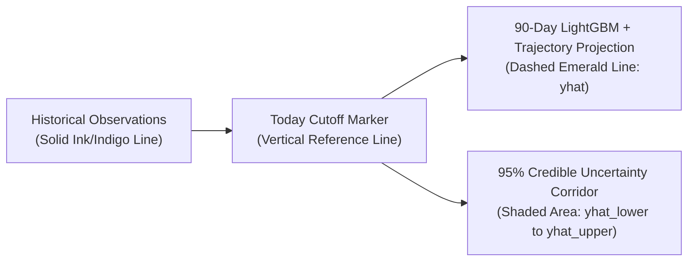

# CreatorIQ: Light-Theme SaaS Trend Cards, Expectancy Models & Trajectory Explainability Guide

**Version:** 3.0 (Production Light-Theme SaaS Architecture)  
**Target Audience:** Product Designers, Frontend Engineers, Technical Interviewers, and Viva Examiners  
**Scope:** Psychology-Driven Light-Theme Design System, Trend Card Hierarchy, The 3 Mathematical Expectancy Cards, 85-Feature LightGBM + 90-Day Trajectory Visualization (`TrendForecastChart.tsx`), and Seamless Strategy Copilot Handoff.

---

## 1. Strict Light-Theme SaaS Design System (`AGENTS.md` Compliance)

CreatorIQ enforces a **high-contrast, white-based analytical SaaS theme** across all public and authenticated routes (`/app/dashboard`, `/app/trends`, `/app/trends/detail/:trendId`, `/app/strategy`, `/app/planner`, `/app/analytics`, `/app/settings`):

| Semantic Token | Hex Value | Usage Across Application |
| :--- | :--- | :--- |
| **Application Canvas** | `#FBFAF8` | Warm off-white main page background reducing eye strain during deep analysis |
| **Elevated Surface** | `#FFFFFF` | Pure white cards, tables, modals, strategy artifact canvas, and chart containers |
| **Secondary Grouping** | `#F6F3FF` | Pale lavender section highlights and active context pills |
| **Primary Action (CTA)** | `#FF98C1` | Pastel pink primary buttons with high-contrast `#171717` ink labels |
| **Positive Signal / Mint** | `#91F5D3` / `#167A59` | Breakout velocity badges, positive momentum deltas, and active connector pills |
| **Primary Ink** | `#171717` | Near-black headings, metric numerals, and primary body copy |
| **Secondary / Muted Ink** | `#625D68` / `#77717F` | Analytical labels, axis ticks, timestamps, and source attributions |
| **Border Token** | `#E5E0E8` | Crisp `1px solid` structural borders separating cards and table cells |

---

## 2. Trend Card Anatomy & Decision Hierarchy (`TrendsPage.tsx`)

Designed around the **DISCOVER → EVALUATE → DECIDE** creator psychology principles, each Trend Card presents evidence in a strict cognitive hierarchy:

```
┌───────────────────────────────────────────────────────────────────────────────┐
│ [Tech & AI]  [Emerging · 87% Viral Prob]  [2.8x Outlier]      [89 Opportunity]│
│                                                                               │
│  "AI Coding Agents Full-Stack Comparison"                                     │
│  Small & mid-sized dev channels are achieving 4.2x subscriber reach           │
│  Source: 6 breakout videos · Top: 142K views (3.4x channel avg) [Watch ↗]     │
│                                                                               │
│  ┌─ Recommended Creator Angle (#F6F3FF Lavender Surface) ──────────────────┐  │
│  │ 🎯 ANGLE                          [🎬 Long-Form / Shorts] [📋 Copy]     │  │
│  │ "Benchmarking 3 Autonomous Coding Agents on a Real Production Bug..."   │  │
│  └─────────────────────────────────────────────────────────────────────────┘  │
│                                                                               │
│  💡 Why It Fits You: Matches your Tech & AI niche + 86% cosine match          │
│                                                                               │
│  TVS Velocity: 84.5/100     Reach Ratio (R_v): 78%     Peak Window: ~16 Days  │
│  [✨ Generate Strategy in Copilot]     [📊 Inspect Evidence]    [🔖 Save]     │
└───────────────────────────────────────────────────────────────────────────────┘
```

### Global Search & URL State Synchronization
- The top navigation search bar in `MainLayout.tsx` routes directly to `/app/trends?q=<encoded_query>`.
- `TrendsPage.tsx` bidirectionally synchronizes its filter state with `useSearchParams()`, allowing creators to deep-link or bookmark filtered niche queries.

---

## 3. The 3 Mathematical Expectancy Cards (`TrendForecastChart.tsx`)

Directly above the interactive trajectory chart on `TrendDetailPage.tsx`, three analytical expectancy cards translate the **85-Feature LightGBM Virality Probability ($P_{\text{viral}}$)** and **90-Day Trajectory Curve** into concrete creator expectations:

### Metric 1: Calibrated View Range (`[Views_low, Views_high]`)
Instead of showing uncalibrated global view totals, CreatorIQ scales the expected view range to the creator's own channel baseline $\mu_{\text{ch}}$ (or tier baseline $B_{\text{tier}}$):

$$M_{\text{reach}} = 1.0 + \left(\frac{\text{TVS}}{100}\right) \times 1.8 + \mathbb{I}(\text{is\_outlier}) \times 0.45$$

$$\text{Views}_{\text{mid}} = B_{\text{tier}} \times M_{\text{reach}} \times \left(1 + \frac{g_{\text{proj}}}{200}\right)$$

$$\text{Views}_{\text{low}} = \text{round}\big(0.72 \cdot \text{Views}_{\text{mid}}\big), \qquad \text{Views}_{\text{high}} = \text{round}\big(1.38 \cdot \text{Views}_{\text{mid}}\big)$$

- **Format Split:** Long-form projection `[0.85 * Views_low, 1.15 * Views_high]` vs. Shorts projection `[1.35 * Views_low, 1.85 * Views_high]`.

### Metric 2: Optimal Publishing Window & Urgency
Derived from theconcept's `lifecycle_stage` and `peak_day_offset` ($d_{\text{peak}}$):
- **`emerging` ($d_{\text{peak}} \in [14, 25]$):** *"Next 48–72 Hours (First-Mover Window)"* — Publish while supply is low and search acceleration is steepest.
- **`growing` ($d_{\text{peak}} \in [10, 18]$):** *"Within 3–5 Days (High-Momentum Wave)"* — Ride sustained algorithmic discovery before peak saturation.
- **`peaking` ($d_{\text{peak}} \in [3, 7]$):** *"Immediate 24–48 Hours (Contrarian / Deep Angle Required)"* — Standard tutorials are saturated; pivot to a contrarian breakdown.
- **`declining`:** *"Hold / Pivot Angle"* — Avoid generic coverage unless pairing with a fresh news hook.

### Metric 3: Algorithmic Reach Multiplier ($M_{\text{reach}}\times$)
Displays the expected multiplier relative to the creator's average upload performance (e.g., `2.6x Channel Average`), paired with the LightGBM `virality_prob` confidence badge.

---

## 4. Interactive 7D / 30D / 90D Trajectory Chart (`TrendForecastChart.tsx`)



- **Horizon Selector Tabs:** Creators can toggle between **7 Days (Tactical)**, **30 Days (Monthly Campaign)**, and **90 Days (Quarterly Trajectory)**.
- **28-Point Visual Downsampling:** For the 90-day view, the chart downsamples the 90 daily points into 28 evenly spaced SVG nodes (always preserving exact historical boundaries and the peak inflection point $d_{\text{peak}}$) so hover tooltips remain crisp and legible on all viewports (`1440px` desktop down to `320px` mobile).
- **1-Click Copilot Handoff:** Clicking **"Develop Strategy in Copilot"** on `TrendDetailPage.tsx` populates `useStrategyStore.attachedTrend` with the full `TrendContextPayload` (including `tvs_score`, `virality_prob`, `lifecycle_stage`, `why_trending`, and `suggested_angle`) and opens `/app/strategy` for immediate script generation and 1-click export to **Google Docs**, **Notion**, or **Google Calendar**.
